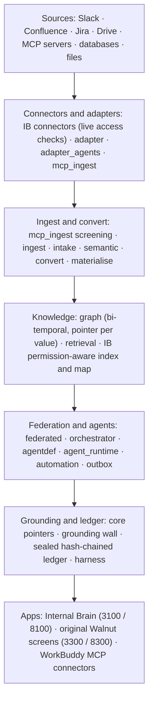

# The Walnut platform: what's in this repo

Walnut DataBridge is two things in one repository. **Internal Brain** (`databridge/apps/internal_brain`
and `databridge/apps/internal_brain_web`) is the ask product judged at the finals. Underneath it sits
**Walnut**, the data platform the team built before the hackathon: **21 Python packages** under
`databridge/packages/`, with **353 test files** between them. Walnut connects sources (MCP servers,
databases, files), screens and ingests what they hold, builds a typed, time-aware knowledge graph in
which every value points back to its source, answers questions across sources by delegating to one
agent per source, converts and materialises data, and runs user-built agents only under compiled
permissions. The original Walnut web app (`databridge/apps/frontend`, port 3300, started by
`demo_up.sh`) shows these capabilities on screen.

The Internal Brain imports four parts of Walnut (section 5) and keeps its own code for the rest, for
reasons stated in that code. Every claim below cites a file or a test. Every test figure was re-run on
30 Oct 2026 on branch `final_v1.2-cloud`, in the cloud Linux checkout, one package at a time (section 7;
the check itself is [finals/reviews/platform_claims_check.md](finals/reviews/platform_claims_check.md)).
Data in this repository is synthetic only.

Contents: 1. What answers, what asks, what shows · 2. The capabilities in depth · 3. The layers · 4. Where
to see each capability · 5. How the Internal Brain uses the platform · 6. Tencent tools in the build ·
7. Notes on the test runs.

## 1. What answers, what asks, what shows

Every capability below falls into one of four groups:

- **Used to answer**: on the path of every Internal Brain answer, or of every file it reads.
- **A way to ask**: another front door onto the same answer path, with the same checks.
- **View**: shows something (what a person can open, how a request went, the ledger); it does not
  produce answers.
- **Not used to answer**: a Walnut platform capability, shown on the original screens (port 3300) only.

### 1.1 The Internal Brain's own path

| # | Capability | Code | Screen | Tests (run 30 Oct) | Group |
|---|---|---|---|---|---|
| A1 | Identity token | `databridge_ib/auth.py` | `/login` | `test_mint_token_cli.py` 9 passed | **Used to answer** |
| A2 | Search index and Gate 1 | `databridge_ib/index.py` | every answer | `test_pipeline_core.py` 11 passed | **Used to answer** |
| A3 | Source connectors and Gate 2 | `databridge_ib/connectors/`, `gates.py`, `authz.py` | every answer; `/dev/sim` | `test_connector_*.py` 4 files, 314 passed | **Used to answer** |
| A4 | Model step | `databridge_ib/llm.py`, `narrate.py`; `packages/harness` | `/dev/analytics` (model use) | `test_llm_chain.py` + `test_model_config.py` 9 passed; harness 36 passed | **Used to answer** |
| A5 | Grounding wall and source pointers | `apps/gateway/databridge_gateway/llm.py`, `databridge_ib/grounding.py`; `core/provenance.py` | every answer; `/dev/journey` | 5 files, 54 passed | **Used to answer** |
| A6 | Sealed, hash-chained ledger | `core/decision_ledger.py`, `databridge_ib/audit/` | `/dev/audit` | core: see row B1; Internal Brain audit: 10 files, 124 passed | **Used to answer** |
| A7 | File readers (uploads, Drive) | `databridge_ib/extract_files.py`; `packages/convert` | Ask (upload) | `test_extract_files.py` 26 passed; `test_uploads.py` 57 passed | **Used to answer** |
| A8 | WorkBuddy (MCP) | `databridge_ib/mcp_server.py`, `audit_mcp_server.py` | inside WorkBuddy | `test_mcp_server.py` + `test_mcp_finals_tools.py` 40 passed; live stdio test 33 of 33 | **A way to ask** |
| A9 | Compare | `internal_brain_web/components/compare/CompareView.tsx` | `/compare` | `tests/e2e/compare.spec.ts` (Playwright; not run here) | **A way to ask** |
| A10 | Knowledge graph (what each person can open) | `databridge_ib/graph.py`, `knowledge_map.py`, `live.py` | `/dev/graph`, `/map` | `test_knowledge_map.py` + `test_graph_doc.py` 33 passed; `test_live_growth.py` 15 passed | **View** |
| A11 | Engine graph (Walnut snapshot) | `databridge_ib/engine_refresh.py`; `packages/graph` | `/dev/brain` | graph package: see row B8; `tests/e2e/engine.spec.ts` (not run here) | **View** |
| A12 | Request journey | `databridge_ib/audit/routes.py` (`/audit/journey/{req_id}`) | `/dev/journey` | `test_dev_views.py` 6 passed | **View** |
| A13 | Audit console | `databridge_ib/audit/` | `/dev/audit` | in the 124 above | **View** |
| A14 | Analytics | `databridge_ib/audit/stats.py` | `/dev/analytics` | `test_dev_views.py` (stats cases); `test_dev_views_hardening.py` 7 passed | **View** |
| A15 | Trust centre | `internal_brain_web/components/trust/TrustCentre.tsx` | `/dev/trust` | `tests/e2e/audit-trust.spec.ts` (not run here) | **View** |

The Internal Brain's whole suite: **1,274 passed, 0 failed, 4 skipped** on the cloud clean checkout of
30 Oct ([STATUS.md](../STATUS.md)). It was not re-run for this note (another long run had the CPU); the
per-file figures above were.

### 1.2 The Walnut packages

"Tests" is the number of `test_*.py` files, then the result of
`python -m pytest packages/<name>/tests -q -m "not integration"` from `databridge/`.

| # | Capability | Package | Screen (port 3300 unless noted) | Tests (run 30 Oct) | Group |
|---|---|---|---|---|---|
| B1 | Shared types, pointers, decision ledger | `core` | every pointer; `/dev/audit` (3100) | 13 files; 276 passed; 1 fails on Linux only (pydantic recursion depth, note e) | **Used to answer** (ledger, value forms) |
| B2 | Adapter contract and policy | `adapter` | `/graph` ask panel, via B12 | 26 files; 667 passed; 1 fails on Linux only (file order, note d) | Not used to answer |
| B3 | MCP ingest | `mcp_ingest` | `/connectors` | 56 files; 854 passed, 7 skipped; 2 fail on Linux only (note f) | Not used to answer |
| B4 | Adapter agents and the adapter builder (the POC) | `adapter_agents` | `/builder`, `/trace` | 23 files; 198 passed | Not used to answer |
| B5 | Schema ingest | `ingest` | none today | 3 files; 10 passed | Not used to answer |
| B6 | Semantic layer | `semantic` | none today | 6 files; 32 passed | Not used to answer |
| B7 | Intake | `intake` | `/intake`, `/frontdesk` | 26 files; 710 passed, 9 skipped | Not used to answer |
| B8 | Knowledge and evidence graph | `graph` | `/graph`, `/brain`, `/ontology`, `/evidence`; `/dev/brain` (3100) | 45 files; 908 passed, 3 skipped | **View** (A11) |
| B9 | Passage retrieval | `retrieval` | used by agents, materialise, MCP ingest | 7 files; 75 passed | Not used to answer |
| B10 | Federated engine (the POC) | `federated` | `/brain` ask panel, `/trace` | 11 files; 138 passed, 4 skipped | Not used to answer |
| B11 | Orchestrator | `orchestrator` | `/graph` ask panel | 1 file; 12 passed | Not used to answer |
| B12 | Agent definitions | `agentdef`, `workflow_spec` | `/builder` | 9 files; 257 passed | Not used to answer |
| B13 | Agent runtime | `agent_runtime` | `/builder`, approval inbox | 14 files; 272 passed, 6 skipped; 2 fail only on the 30th of a month (note b) | Not used to answer |
| B14 | Automation | `automation` | `/builder` | 15 files; 239 passed, 2 skipped | Not used to answer |
| B15 | Outbox (send gate) | `outbox` | `/intelligence` action cards | 8 files; 142 passed | Not used to answer |
| B16 | Read-only clinic agent | `agent` | `/intelligence` | 12 files; 324 passed | Not used to answer |
| B17 | Convert | `convert` | `/data#convert`; Internal Brain uploads (A7) | 37 files; 519 passed, 18 skipped; 2 need the optional `readability-lxml` module (note c) | **Used to answer** (file readers) |
| B18 | Materialise | `materialise` | `/data#agent` | 28 files; 371 passed | Not used to answer |
| B19 | Model harness | `harness` | `/dev/analytics` (3100) | 7 files; 36 passed | **Used to answer** (A4) |
| B20 | Evals | `evals`; `databridge/evals/internal_brain` | `/evals`; `RESULTS.md` | 6 files; 23 passed | Checks the answers |

Screens on port 3300 are `databridge/apps/frontend/app/<path>/page.tsx` (for example
`app/builder/page.tsx`); screens on port 3100 are `databridge/apps/internal_brain_web/app/<path>/page.tsx`.

## 2. The capabilities in depth

### 2.1 The Internal Brain's answer path (used to answer)

The order is fixed in `databridge_ib/pipeline.py:1-12`: sign-in, ledger `request.accepted`, Gate 1 and
ranking, Gate 2 per candidate, ledger `retrieval.decided`, the model step, the grounding wall, ledger
`answer.released`, then the response. A ledger failure aborts the request.

**A1. Identity token.** The person is only ever the `sub` of a signed, short-lived token: HMAC-SHA256
over `{sub, roles, exp, aud, jti}`, read from the `ib_session` cookie (web) or a Bearer header (MCP); no
request body, tool argument or model output can name a person (`databridge_ib/auth.py:1-6`; `mint` :34,
`verify` :45, revocation `revoke` :134). Tokens for WorkBuddy are minted by
`databridge/scripts/ib_mint_token.py`. Tests: `test_mint_token_cli.py`, 9 passed. Screen: `/login`.

**A2. Search index and Gate 1.** The Internal Brain keeps its own index so that ranking never depends on
a document the asker cannot read: BM25 statistics are computed over the asker's readable chunks only,
vector similarity is per chunk, and the bonuses read only the candidate chunk
(`databridge_ib/index.py:1-13`). Gate 1 is `Index.readable(user)` (`index.py:289`): each document's
stored source permission, evaluated at query time; `search` (`:301`) ranks only that set. The vector side
uses the harness's offline embedder (`index.py:159-160`). Tests: `test_pipeline_core.py` (11 passed),
including `test_p1_restricted_never_in_any_prompt` and `test_p2_differential_world_with_and_without_restricted`.

**A3. Source connectors and Gate 2.** One connector per platform (Slack, Confluence, Jira, Drive)
implements `SourceConnector` (`connectors/base.py:1-8`) over an injected HTTP client, so the mock
platforms and a real service use the same code path. `acl()` compiles the platform's own permission
model into a policy expression for Gate 1; Gate 2 then asks the source, live and with no cache, whether
the person may read each candidate now, and a timeout, a 429, an error or a missing connector is a deny
(`gates.py:1-5`, `check_all` :28). Every read outside an answer (graph, document view, receipts) goes
through the same rule (`authz.py:1-12`). Tests: `test_connector_confluence.py`, `_drive.py`, `_jira.py`,
`_slack.py`: 4 files, 314 passed (183 test functions, some parametrised); revocation:
`test_pipeline_core.py::test_s4_revocation_at_source_wins_over_stale_index`. The platforms are mocks with
the real API shapes (`databridge/apps/mock_platforms`).

**A4. Model step.** All model calls go through `databridge_harness.Harness` (`databridge_ib/llm.py:81`).
The chain starts with Tencent Hunyuan (Hy3) on TokenHub (`DEFAULT_CHAIN`, `llm.py:30`), then an optional
stand-in model, then the extractive path, which quotes the released passages and needs no model
(`narrate.py:1-6`). `scripts/hy3_check.py` reports whether TokenHub answers; Hy3 has not run live in this
product. Tests: `test_llm_chain.py` and `test_model_config.py`, 9 passed (with a capturing test model,
no live call); harness 36 passed. Screen: `/dev/analytics` shows which model answered.

**A5. Grounding wall and source pointers.** Walnut values carry a `SourcePointer`
(`core/provenance.py:297`), and a cell is grounded, withheld or absent (`GroundedValue` :502, `Withheld`
:686). The grounding wall in `apps/gateway/databridge_gateway/llm.py` binds each sentence of a model
answer to a cited passage and drops what it cannot bind (`ground_narration` :1105, `bind_sentences`
:1273, `GroundedNarrator` :1332); the Internal Brain loads it without the legacy gateway's routes
(`databridge_ib/grounding.py:1-37`) and applies it to every model answer (`narrate.py:14`). Tests:
`gateway/tests/test_fin08_values_compared_by_value.py`, `test_llm_codex_f1_r2.py`, `test_llm_codex_f2.py`
(44 passed) and the Internal Brain's `test_contracts.py`, `test_llm_chain.py` (10 passed): 5 files, 54
passed. Limit: it checks values and names, not the relations between them (INTERNAL_BRAIN.md, Honest
limits). Screen: `/dev/journey`.

**A6. Sealed, hash-chained ledger.** `DecisionLedger` (`core/decision_ledger.py:530`) appends records
whose digests (`digest_of` :232) are sealed with a key (`seal_of` :237) and chained, under a
cross-process append lock. The Internal Brain writes every request ahead to it (`audit/ledger.py:34`), and
`/dev/audit` verifies the chain and the stored content (`audit/tamper.py:46`). Limit: a holder of the
sealing key could rewrite records after the last off-host head publication (`docs/tencent/SECURITY.md`
§3). Tests: `core` (row B1) and the Internal Brain's `test_audit_*.py` and `test_tamper_demo_route.py`:
10 files, 124 passed.

**A7. File readers.** Uploaded files and Drive files are read by `databridge_convert` readers for CSV,
XLSX, DOCX, PPTX, PDF, Markdown and text (`databridge_ib/extract_files.py:356-363`); the text then goes
through the same index, gates and ledger as any other document. Tests: `test_extract_files.py` 26 passed,
`test_uploads.py` 57 passed; `convert` row B17.

### 2.2 Ways to ask

**A8. WorkBuddy (MCP).** Three MCP connectors, `ib-as-jdoe`, `ib-as-ken` and `ib-compliance`
(`databridge_ib/mcp_server.py`, `audit_mcp_server.py`), let people ask from inside WorkBuddy. No tool
takes a user or a name: the signed token (A1) is the person, the call goes through the same answer path,
and the ledger row carries channel `workbuddy-mcp`; source text is framed as untrusted data
(`mcp_server.py:42-50`). Tests: `test_mcp_server.py` (26) and `test_mcp_finals_tools.py` (14), 40
passed; every tool of both servers was driven over stdio with the official MCP client, 33 of 33 checks
([workbuddy_live_test.md](finals/rubric/ai_innovation/workbuddy_live_test.md)).

**A9. Compare.** The same question for two people, or one person with two questions, side by side
(`app/compare/page.tsx`, `components/compare/CompareView.tsx`). Each column is a separate signed-in
session that calls the normal ask endpoint, so the difference shown is exactly what Gates 1 and 2 let
each person see. Tests: `tests/e2e/compare.spec.ts` (Playwright; not run for this note).

### 2.3 Views (do not answer)

**A10. Knowledge graph: what each person can open.** One graph of everything the signed-in person may
open, built only from documents confirmed in that call: Gate 1 picks candidates, Gate 2 confirms each
live, edges join only two confirmed documents, and hidden counts are shown only when exact
(`databridge_ib/graph.py:1-25`, `build_graph` :122; the list form is `knowledge_map.py`, and live growth
is `live.py`). Screens: `/dev/graph` (Explore and two-person Compare) and `/map`. Tests:
`test_knowledge_map.py` + `test_graph_doc.py` 33 passed; `test_live_growth.py` 15 passed.

**A11. Engine graph.** `/dev/brain` shows the Walnut graph (B8) of Company A as one person (`jdoe`) sees
it, from a build-time snapshot (`scripts/build_enterprise_graph.py`, refreshed by
`databridge_ib/engine_refresh.py:1-25`). It is not re-checked live, so it never answers questions.

**A12. Request journey.** One request end to end, its stages and timings, with no answer text
(`audit/routes.py:10`, `GET /audit/journey/{req_id}`; compliance only). Screen: `/dev/journey`. Tests:
`test_dev_views.py::test_journey_is_compliance_only_and_has_no_answer_text`.

**A13. Audit console.** Query the ledger in plain words (rules first, the model only as a fallback
parser: `audit/nl_filter.py`, `nl_llm.py`), verify the chain and content, and run the tamper demo on a
copy (`audit/tamper.py`). Screen: `/dev/audit` (compliance officer). Tests: in the 124 of A6.

**A14. Analytics.** Outcome counts, refusal reasons, model use and timings over a window, computed from
the ledger (`audit/stats.py:43` `compute_stats`). Screen: `/dev/analytics`. Tests: `test_dev_views.py`
(6 passed, including `test_stats_needs_compliance_and_is_ledgered`) and `test_dev_views_hardening.py` (7
passed).

**A15. Trust centre.** The responsible-AI evidence pack as an in-app page: static, self-assessed, and
every claim names the test or eval behind it (`components/trust/TrustCentre.tsx:2-3`, data in
`components/trust/data.ts`). Screen: `/dev/trust`. Tests: `tests/e2e/audit-trust.spec.ts` (not run here).

### 2.4 Walnut packages: connect sources

**B2. Adapter contract and policy.** The contract between an orchestrator and any source, with no I/O
in it: no driver, no credentials, no network call (`adapter/databridge_adapter/__init__.py:1-7`). A
reader sends one frozen `CapabilityRequest` (`contract.py:217`) whose principal-independent `read_hash`
becomes the snapshot's query hash, which is what makes a citation verifiable by re-execution. Each
source answers through its own `PolicyEngine` (`policy.py:437`) behind an `AdapterShell` (`shell.py:87`).
Tests: 667 passed; 1 fails on Linux only (file order, note d) (note d).

**B3. MCP ingest.** "Connect any MCP server, and Walnut extracts from it on its own"
(`mcp_ingest/databridge_mcp_ingest/__init__.py:1`). Declare a connection, propose a crawl plan and have a
person approve it (`plans.py:1363`, `:1766`), capture raw bytes, extract, screen, build closed-vocabulary
graph rows with a pointer per value, reconcile and report (`runner.py:792` `run_ingest`). The screen is
pattern matching and arithmetic only and runs before any model (`screen.py:1-4`); card numbers are
checked by Luhn and IBANs by mod 97 (`screen.py:141`). Tests: 854 passed, 7 skipped; 2 fail on Linux only (note f). Screen: `app/connectors`.

**B4. Adapter agents and the adapter builder.** An adapter agent is a managed group of MCP connections:
approved crawl plans, sync schedule, screening policy, freshness target, health, and proposals for
ontology kinds it keeps meeting and cannot store (`AdapterAgentManager`, `manager.py:165`; `sync` :667;
`health` :1044). On `/builder` a person describes an agent or an adapter agent in plain English
(`apps/frontend/app/builder/page.tsx`); the gateway compiles it (`builder_routes.py`) and serves the
adapter agents at `/adapter-agents/*` (`adapter_agents_routes.py`). Tests: 23 files, 198 passed. Not used
by the Internal Brain.

**B5. Schema ingest.** `SchemaExtract` models, a fixture loader (`ingest/databridge_ingest/fixtures.py:18`)
and a PostgreSQL schema reader loaded only on use (`postgres.py:110`). Tests: 3 files, 10 passed.

**B6. Semantic layer.** A deterministic schema graph (`semantic/databridge_semantic/schema_graph.py:107`),
a model annotator for tables and columns (`annotator.py:224`), confidence blending with a second-model
vote, and a confirmation session in which mandatory reviews are done by a person. Tests: 6 files, 32
passed.

**B7. Intake.** Walnut's earlier front-desk pipeline: classify, extract, ground every field to its source
span, match registry candidates (never confirm an identity), pre-fill the form, draft billing for staff
approval (`intake/databridge_intake/pipeline.py:60` `run_intake`). Tests: 26 files, 710 passed, 9 skipped.
Screens: `app/intake`, `app/frontdesk`.

### 2.5 Walnut packages: know

**B8. Knowledge and evidence graph.** A typed, bi-temporal graph over SQLite: every row has a valid time
and a system time, and `as_of` (`graph/databridge_graph/query.py:76`) returns the graph as it was. The
vocabulary is closed and comes from domain packs (`databridge/packs/`), and `load_pack_graph`
(`estate_seed.py:1133`) builds the graph with every node and link citing its source row. Tests:
908 passed, 3 skipped. Screens: `app/graph`, `app/brain`, `app/ontology`, `app/evidence`; `/dev/brain` (A11).

**B9. Passage retrieval.** Hybrid, routed passage search over captured documents (`search.py:551`,
`deep_search` :557; `indexer.py:951`, `:183`). Tests: 7 files, 75 passed. Not used by the Internal Brain,
which keeps its own index (A2).

### 2.6 Walnut packages: ask across sources and run agents

**B10. Federated engine.** The planner splits a cross-source question into sub-tasks, by rules first and
otherwise through the harness, validated against a catalogue measured from the adapter-agent registry
(`planner.py:711`). Each adapter agent answers its sub-task read-only (`delegates.py`), and the combine
step uses `Decimal`-exact aggregates and no model arithmetic (`combine.py:412`; `FederatedService.answer`,
`service.py:324`; gateway `POST /federated/ask`). Tests: 11 files, 138 passed, 4 skipped. Screens:
`app/brain` ask panel, `app/trace`. Not used by the Internal Brain.

**B11. Orchestrator.** Picks the adapters that can answer from their declared capabilities, briefs each
`AdapterShell`, and lets each adapter's own policy decide what comes back (`Orchestrator.ask`,
`orchestrator.py:238`). Tests: 1 file, 12 passed. Screen: `app/graph` ask panel.

**B12. Agent definitions.** An agent is a `WorkflowSpec` (`workflow_spec/.../models.py:489`) plus an
agentdef declaration; `compile_agent` (`agentdef/.../compiler.py:278`) turns the declaration into a
capability grant set, a sink policy, a budget record and an eval binding, or refuses, and an agent that
will not compile cannot run. Tests: 9 files, 257 passed (agentdef 128, workflow_spec 129). Screen:
`app/builder`.

**B13. Agent runtime.** Runs a user-defined agent under its compiled grants; every claim must cite a
pointer, and every write becomes a proposal a named human approves, rejects or reverses (`run_agent`,
`runtime.py:1139`; `approve` :1938). Tests: 14 files, 272 passed, 6 skipped, and 2 that fail only when
run on the 30th of a month (note b). Screen: `app/builder`, approval inbox.

**B14. Automation.** Plain English in, a governed automation out: rules first, then the model, then
validation against the live catalogue (`compile_english`, `compiler.py:630`); the `TriggerEngine`
(`engine.py:369`) runs cron, event tailing and idempotency keys. Tests: 15 files, 239 passed, 2 skipped.

**B15. Outbox.** The agent drafts, a human approves, a separate model-free process sends; the package
holds no transport and no model, and `tests/test_outbox_cannot_send.py` checks both (`OutboxStore`,
`store.py:236`). Tests: 8 files, 142 passed.

**B16. Read-only clinic agent.** From Walnut's earlier healthcare work: reads through sealed adapters and
answers with citations; it cannot send or decide who a patient is (`ClinicAgent`, `agent.py:297`).
Tests: 12 files, 324 passed.

### 2.7 Walnut packages: shape data and check

**B17. Convert.** A conversion router (`router/router.py:29` `route`, `:84` `convert`) over readers and
writers for CSV, Excel, JSON, JSONL, Parquet, Arrow, XML, YAML, HTML and Markdown tables, and document
sources (PDF text and OCR, DOCX, PPTX, HTML, email, images), with rule-based coercion, validators and a
quarantine store. Tests: 37 files, 519 passed, 18 skipped; 2 HTML tests need the optional
`readability-lxml` module (note c). Screen: `app/data` (convert tab); used by A7.

**B18. Materialise.** The plan is the dataset's identity: `plan_hash` names it, and re-executing the plan
against pinned snapshots must reproduce `content_hash`. The compiler refuses leaky plans (features on the
wrong time axis, labels with no maturity lag; `compiler.py:553`), and the executor (`executor.py:278`)
writes a receipt for every build. Tests: 371 passed. Screen: `app/data` (agent tab).

**B19. Model harness.** The only package allowed to import a vendor SDK, and where the airgapped profile
is enforced (`harness/databridge_harness/__init__.py:1-4`): `Harness` (`client.py:104`) adds budgets and
structured output, and `hashing_embed` (`embedding.py:109`) is an offline embedder. Tests: 7 files, 36
passed. Used by A2 and A4.

**B20. Evals.** Platform evals for schema annotation, SQL, intake and retrieval (`e1.py:55`,
`e_retrieval.py:70`): 6 files, 23 passed. The Internal Brain's leak evaluation is separate: 0 leaks in
7,374 requests (`databridge/evals/internal_brain/RESULTS.md`).

## 3. The layers

Two rules hold the layers together: `core` is the dependency root and has no model or vendor imports
(`packages/core/databridge_core/__init__.py:3-4`), and `harness` is the only package allowed to import
a vendor SDK (`packages/harness/databridge_harness/__init__.py:3-4`).

## 4. Where to see each capability

1. **Finals app** (`bash databridge/scripts/demo_up.sh start`, port 3100): every answer uses A1 to A6;
   uploads use A7. Developer mode has `/dev/graph`, `/dev/brain`, `/dev/journey`, `/dev/audit`,
   `/dev/analytics`, `/dev/sim` and `/dev/trust`; User mode has Ask, `/compare`, `/history`, `/map`.
2. **Original Walnut screens** (port 3300, same script; `databridge/apps/frontend/README.md`): `/graph`,
   `/brain`, `/ontology`, `/evidence` and `/demo` on Company A; the sidebar also lists Sources
   (`/connectors`), Builder, Activity (`/trace`), Intelligence and Data. On Company A nothing is ingested
   live, so Sources, Builder and Activity start empty.
3. **Gateway routes**: `databridge/apps/gateway/databridge_gateway/` (`federated_routes.py`,
   `adapter_agents_routes.py`, `builder_routes.py`, `agents_routes.py`, `automation_routes.py`,
   `orchestrator_routes.py`, `materialise_routes.py`, `mcp_routes.py`, `graph_routes.py`).

## 5. How the Internal Brain uses the platform

Measured with `grep -rhoE "databridge_[a-z_]+" databridge/apps/internal_brain/databridge_ib` (tests
excluded): the only Walnut modules it imports are `databridge_core`, `databridge_harness`,
`databridge_convert` and `databridge_gateway` (for the grounding wall alone).

1. **`core`**: the sealed ledger (`audit/ledger.py:34`, `audit/tamper.py:46`) and value forms for the
   number checks in deliverables (`deliverables/verify.py:55`).
2. **The grounding wall** from `apps/gateway/databridge_gateway/llm.py`, loaded without the gateway's
   routes (`databridge_ib/grounding.py:1-37`).
3. **`harness`**: the model chain (`databridge_ib/llm.py:81`) and the offline embedder
   (`databridge_ib/index.py:160`).
4. **`convert`**: the file readers (`databridge_ib/extract_files.py:356-363`).

It does **not** import `retrieval` or `graph`: it keeps its own index and its own map, so that no
ranking statistic depends on a document the asker cannot open (`index.py:1-13`, `graph.py:1-25`). It
does not use the adapter package, MCP ingest, the adapter agents, the adapter builder, the federated
engine, the orchestrator, the agent packages, materialise or the outbox.

## 6. Tencent tools in the build

1. **CodeBuddy.** Nine recorded build sessions, CB1 to CB9 (`docs/tencent/DEV_PROCESS.md`, table at
   lines 47-55). CodeBuddy built both WorkBuddy MCP connectors (CB2, CB3), the token CLI and the
   model-chain tests (CB3, CB4), hardened its own connectors (CB6), upgraded them for the finals (CB8) and
   wrote the WorkBuddy skill (CB9); CB5 and CB7 were security reviews (CB5: seven findings, three fixed
   with tests; CB7: eight findings, F7 fixed with tests). Sessions CB1, CB5, CB7 and CB9 ran on `hy3`.
   Evidence: prompts in `docs/tencent/evidence/codebuddy_prompts/`, transcripts
   `docs/tencent/evidence/codebuddy_cb1.jsonl` to `codebuddy_cb9.jsonl` (CB8 also has part 2 and part 3),
   20 session images in `submission/01_codebuddy/` (overview and full for CB1 to CB9 and CB8 part 3),
   and `submission/01_codebuddy/conversation_history_codebuddy_workbuddy_miora.pdf`.
2. **WorkBuddy.** The three MCP connectors of A8. Evidence: the live stdio test,
   `docs/finals/rubric/ai_innovation/workbuddy_live_test.md` (33 PASS rows, 0 FAIL) produced by
   `docs/tencent/evidence/workbuddy_live_test.py`; 40 MCP tests; screenshots in `submission/02_workbuddy/`
   (first round); the finals GUI retest checklist `docs/finals/rubric/ai_innovation/WORKBUDDY_GUI_TEST.md`.
3. **Miora.** The finals cover, from a Miora session on 30 Oct. Evidence in `submission/06_cover/finals/`:
   `miora_session_finals.png` (the session), `cover_finals_option1_raw.png` and
   `cover_finals_option2_raw.png` (the two outputs), `cover_finals_1920x1080.png`,
   `cover_finals_380x216.png` and `youtube_thumbnail_finals_1280.png`; prompt in
   `docs/finals/COVER_MIORA_PROMPT.md`. Two earlier sessions (`submission/06_cover/miora_session1.png`,
   `miora_session2.png`) made the submission cover.
4. **Hunyuan (Hy3) via TokenHub.** First in the Internal Brain's model chain (`databridge_ib/llm.py:30`)
   on the TokenHub Singapore endpoint. **Wired, not live:** tested with a capturing test model
   (`test_llm_chain.py`, `test_model_config.py`), and `scripts/hy3_check.py` reports whether TokenHub
   answers; until it is activated, answers are quoted from the sources and say so.
5. **Tencent Cloud Lighthouse.** A deploy kit in `deploy/lighthouse/`: `Dockerfile.ib`, `Dockerfile.web`,
   `docker-compose.yml`, `Caddyfile` (HTTPS), a passcode-gated demo, ports 80 and 443 only, `deploy.sh`,
   `upload.sh`, `smoke.sh`. No live instance (Lighthouse capacity was sold out;
   `deploy/lighthouse/README.md:3`); the demo runs locally.

Not used: Tencent RTC. Voice dictation is the browser's own speech service.

## 7. Notes on the test runs

30 Oct 2026, cloud Linux checkout of `final_v1.2-cloud`, `/home/user/venv` (Python 3.13), from
`databridge/`, one package at a time, `python -m pytest packages/<name>/tests -q -m "not integration"`,
no time cap. Internal Brain files were run with
`PYTHONPATH=apps/internal_brain:packages/core:packages/harness:packages/adapter:packages/retrieval`.

- **(a) Child processes could not import the packages (fixed).** The venv does not install the
  packages; `pytest`'s `pythonpath` setting adds them to the test process only. Tests that start a child
  Python (`core/tests/test_decision_ledger.py::test_the_append_lock_is_cross_process`,
  `graph/tests/test_deprecated_kinds_are_not_extracted.py::test_concurrent_writer_processes_lose_no_records`)
  failed with `ModuleNotFoundError: databridge_core`. `databridge/conftest.py` now exports the same paths
  in `PYTHONPATH`, and both pass.
- **(b) `agent_runtime`: two tests fail on the 30th of any month.**
  `test_e2e_run2_rtf2.py::test_n06_a_derivation_that_does_not_replay_from_cited_inputs_refuses` (cases
  `bad1` and `bad3`) expect the value `30` (days between 15 Sep and 15 Oct) to be refused as ungrounded.
  The run context the agent is given includes today's date, which counts as grounded, so on a date with
  `30` in it the value is grounded and the write goes through. With the clock fixed to 29 Oct the test
  passes (8 of 8 `n06` cases); fixed to 30 Oct it fails the same 2. A test-date clash in
  `packages/agent_runtime/tests`, which this pass does not modify.
- **(c) `convert`: two HTML tests need `readability-lxml`.** `test_document_adapters.py::
  test_html_main_content_extraction_and_loss` and `::test_html_to_md_loss_nonempty` stop at
  `ModuleNotFoundError: No module named 'readability'`. The module is an optional dependency that is not
  in `requirements-lock.txt` or `packages/convert/pyproject.toml`; installed in a scratch folder, the
  file passes (23 of 23). The Internal Brain does not use the HTML reader.
- **(d) `adapter`: one fixture pin fixed; one test depends on file order.** The MCP fixture's artefact
  pin in `fixtures/packs/government/adapters/permits_registry_mcp.yaml` was the digest of a CRLF copy
  of `fixtures/mcp/permits_mcp/server.py`; the repository stores the file with LF endings, so all 48
  tests in `test_mcp_adapter.py` stopped at `ServerQuarantined`. Converting today's file to CRLF
  reproduces the old pin exactly, so the content is unchanged and the pin was updated to the LF digest.
  `test_document_adapter.py::test_verify_resolves_against_the_capture_and_the_live_file_only_answers_vanished`
  deletes the first `*.dat` file that `glob` returns and expects the cited record to vanish; on Linux
  `glob` is not sorted, so it deletes a different shard. With `glob` sorted the file passes (44 of 44).
- **(e) `core`: one test depends on the platform.**
  `test_trust_lattice_cannot_be_laundered.py::test_a_pointer_chain_deeper_than_pydantics_recursion_guard_is_refused`
  builds a 200-link pointer chain and expects pydantic's recursion guard to refuse it. On this Linux
  machine (pydantic 2.14.1, pydantic-core 2.50.1) the guard trips at 254 links, so 200 is accepted; the
  laptop run on Windows did not fail it.
- **(f) `mcp_ingest`: two tests fail on Linux only.**
  `test_s1_files_blob.py::test_relative_escapes_are_refused[..\\outside.md]` expects a backslash path to
  be refused as an escape from the root; on Linux a backslash is an ordinary file-name character, so the
  path stays inside the root and is not refused (the four other cases, including `../outside.md`, pass).
  `test_fxi3_sources.py::test_8_an_allow_listed_runner_still_needs_the_risk_acceptance` expects the
  interpreter to be treated as a code runner; here `sys.executable` resolves to `/usr/bin/python3.13`,
  and the runner list in `databridge_mcp_ingest/connections.py` (`CODE_RUNNERS`, line 386) matches
  `python` and `python3` but not a versioned name, so the extra risk acceptance is not asked for. On
  Windows the name is `python.exe` and the test passes. The second one is a real gap in the runner check
  (a versioned interpreter name is not recognised), recorded here and not fixed in this pass because it
  is in `databridge/packages/`. Neither is on the Internal Brain's path.
