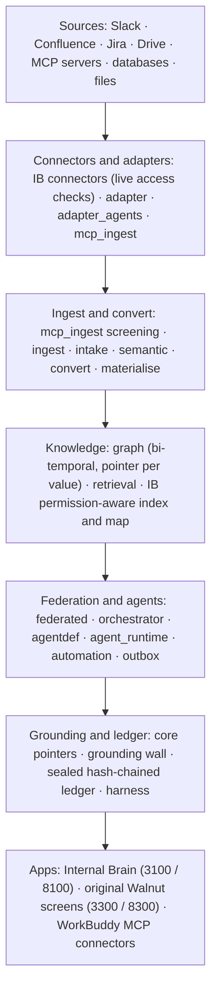

# The Walnut platform: what's in this repo

Walnut DataBridge is two things in one repository. **Internal Brain** (`databridge/apps/internal_brain`
and `databridge/apps/internal_brain_web`) is the ask product judged at the finals. Underneath it sits
**Walnut**, the data platform the team built before the hackathon: **21 Python packages** under
`databridge/packages/`, with **353 test files** between them. Walnut connects sources (MCP servers,
databases, files), screens and ingests what they hold, builds a typed, time-aware knowledge graph in
which every value points back to its source, answers questions across sources by delegating to one
agent per source, converts and materialises data, and runs user-built agents only under compiled
permissions. The original Walnut web app (`databridge/apps/frontend`, port 3300, started by
`demo_up.sh`) shows these capabilities on screen. The Internal Brain reuses four of them directly
(section 5) and keeps its own code for the rest, for reasons stated in that code.

Every claim below cites a file or a test. Every count was measured on branch `docs/platform-overview`
(from `final_v1.2-cloud`, 30 Oct 2026). Data in this repository is synthetic only.

Contents: 1. Capability table · 2. The capabilities in depth · 3. The layers · 4. Where to see each
capability · 5. How the Internal Brain uses the platform · 6. Tencent tools in the build · 7. Notes on
the test runs.

## 1. Capability table

"Tests" is the number of `test_*.py` files, then the result of
`python -m pytest packages/<name>/tests -q -m "not integration"` with the repo's Python 3.13 venv, run
package by package with a 2-minute cap ("not run" = over 2 minutes; section 7 has the notes).
"Used by the Internal Brain?" is checked by `grep` over `databridge/apps/internal_brain/databridge_ib`
(section 5): **yes** = on the answer or audit path; **shown** = visible in the finals app or the original
screens, not used to answer; **platform capability** = not used by the Internal Brain.

| # | Capability | Package | Where you can see it | Tests | Used by the Internal Brain? |
|---|---|---|---|---|---|
| 1 | Source connectors (Slack, Confluence, Jira, Drive) | `apps/internal_brain/databridge_ib/connectors/` | Every Internal Brain answer; `/dev/sim` | 4 files, 183 tests (Internal Brain suite) | **Yes** |
| 2 | Adapter contract and policy | `adapter` | `/graph` ask panel (port 3300), via row 12 | 26 files; not run | Platform capability |
| 3 | MCP ingest | `mcp_ingest` | `/connectors` (port 3300) | 56 files; not run | Platform capability |
| 4 | AI adapter agents and the adapter builder | `adapter_agents` | `/builder`, `/trace` (port 3300) | 23 files; not run | Platform capability |
| 5 | Schema ingest | `ingest` | No screen today | 3 files; 10 passed | Platform capability |
| 6 | Semantic layer | `semantic` | No screen today | 6 files; 32 passed | Platform capability |
| 7 | Intake | `intake` | `/intake`, `/frontdesk` (port 3300) | 26 files; 710 passed, 9 skipped | Platform capability |
| 8 | Knowledge and evidence graph | `graph` | `/dev/brain`; `/graph`, `/brain`, `/ontology`, `/evidence` (port 3300) | 45 files; not run | **Shown** |
| 9 | Per-person knowledge map | `apps/internal_brain/databridge_ib/graph.py` | `/dev/graph` | 2 files, 33 tests (Internal Brain suite) | **Shown** |
| 10 | Passage retrieval | `retrieval` | Used by agents, materialise and MCP ingest | 7 files; 75 passed | Platform capability |
| 11 | Federated engine | `federated` | `/brain` ask panel, `/trace` (port 3300) | 11 files; 138 passed, 4 skipped | Platform capability |
| 12 | Orchestrator | `orchestrator` | `/graph` ask panel (port 3300) | 1 file; 12 passed | Platform capability |
| 13 | Agent definitions | `agentdef`, `workflow_spec` | `/builder` (port 3300) | 9 files; 257 passed | Platform capability |
| 14 | Agent runtime | `agent_runtime` | `/builder`, approval inbox (port 3300) | 14 files; 272 passed, 6 skipped, 2 failed (note b) | Platform capability |
| 15 | Automation | `automation` | `/builder` (port 3300) | 15 files; 239 passed, 2 skipped | Platform capability |
| 16 | Outbox (send gate) | `outbox` | `/intelligence` action cards (port 3300) | 8 files; 142 passed | Platform capability |
| 17 | Read-only clinic agent | `agent` | `/intelligence` (port 3300) | 12 files; 324 passed | Platform capability |
| 18 | Convert | `convert` | `/data#convert` (port 3300); Internal Brain uploads | 37 files; 519 passed, 18 skipped, 2 failed (note c) | **Yes** |
| 19 | Materialise | `materialise` | `/data#agent` (port 3300) | 28 files; not run | Platform capability |
| 20 | Grounding wall with source pointers | `apps/gateway/databridge_gateway/llm.py`, `core` | Every Internal Brain answer; `/dev/journey` | 5 test files call it | **Yes** |
| 21 | Sealed, hash-chained decision ledger | `core` | `/dev/audit` | 13 files; 276 passed, 1 failed (note a); plus 11 Internal Brain audit files, 109 tests | **Yes** |
| 22 | Model harness | `harness` | `/dev/analytics` (model fallback) | 7 files; 36 passed | **Yes** |
| 23 | Evals | `evals`; `databridge/evals/internal_brain` | `/evals` (port 3300); `RESULTS.md` | 6 files; 23 passed | Checks the answers |

The Internal Brain's own suite (rows 1, 9 and the audit half of 21): **1,274 passed, 0 failed, 4
skipped** on the cloud clean checkout of 30 Oct ([STATUS.md](../STATUS.md), line 57).

## 2. The capabilities in depth

### 2.1 Connect sources

**1. Source connectors.** One connector per platform implements the `SourceConnector` protocol
(`databridge_ib/connectors/base.py:1-8`). Each talks to the platform's HTTP API through an injected
client whose base URL is either the mock platform or the real service, so the mock is a stand-in on the
same code path, not a fork. `acl()` compiles the platform's native permission model into a policy
expression, and access is re-checked live before a passage is used (Gate 2).
Files: `connectors/slack.py`, `confluence.py`, `jira.py`, `drive.py`. Tests: `test_connector_*.py`
(4 files, 183 tests). The platforms are mocks with the real API shapes (README, Honest limits).

**2. Adapter contract and policy.** The contract between an orchestrator and any source, with no I/O
in it: no driver, no credentials, no network call (`adapter/databridge_adapter/__init__.py:1-7`). A
reader sends one frozen `CapabilityRequest` (`contract.py:217`) whose principal-independent `read_hash`
becomes the snapshot's query hash, which is what makes a citation verifiable by re-execution. Each
source answers through its own `PolicyEngine` (`policy.py:437`) behind an `AdapterShell`
(`shell.py:87`). Tests: 26 files (not run here: over 2 minutes).

**3. MCP ingest.** "Connect any MCP server, and Walnut extracts from it on its own"
(`mcp_ingest/databridge_mcp_ingest/__init__.py:1`). The steps: declare a connection, propose a crawl plan
(profiles first, then the model) and have a person approve it (`plans.py:1363`, `:1766`), capture raw
bytes content-addressed, extract, screen, build closed-vocabulary graph rows with a pointer per value,
reconcile, report (`runner.py:792` `run_ingest`). The screen is pattern matching and arithmetic only and
runs before any model, per document and per chunk (`screen.py:1-4`); card numbers are checked by Luhn and
IBANs by mod 97 (`screen.py:141`). Tests: 56 files (not run here).

**4. AI adapter agents and the adapter builder.** An adapter agent is a managed group of MCP
connections: their approved crawl plans, sync schedule, screen and extract policy, freshness target,
health, and proposals for ontology kinds it keeps meeting and cannot store
(`adapter_agents/databridge_adapter_agents/__init__.py:1-8`; `AdapterAgentManager`, `manager.py:165`;
`sync` :667; `health` :1044). On `/builder` a person describes an agent or an adapter agent in plain
English (`apps/frontend/app/builder/page.tsx:2-6`); the gateway compiles it
(`builder_routes.py`: `/builder/adapter/compile`, `/builder/agent/compile`) and serves the adapter agents
at `/adapter-agents/*` (`adapter_agents_routes.py`). Tests: 23 files (not run here).

**5. Schema ingest.** `SchemaExtract` models, a fixture loader (`ingest/databridge_ingest/fixtures.py:18`)
and a PostgreSQL schema reader loaded only on use (`postgres.py:110`). Tests: 3 files, 10 passed.

**6. Semantic layer.** A deterministic schema graph (`semantic/databridge_semantic/schema_graph.py:107`),
a model annotator for tables and columns (`annotator.py:224`), confidence blending with a second-model
vote (`confidence.py`), and a confirmation session in which mandatory reviews must be done by a person
(`confirmation.py`). Tests: 6 files, 32 passed.

**7. Intake.** Walnut's Hack4Health front-desk pipeline, before this hackathon: classify, extract,
ground every field to the source span it came from, match registry *candidates* (never confirm an
identity), resolve coverage, pre-fill the form, draft billing for staff approval
(`intake/databridge_intake/__init__.py:1-12`; `pipeline.py:60` `run_intake`). Tests: 26 files, 710 passed.

### 2.2 Know

**8. Knowledge and evidence graph.** A typed, bi-temporal operational graph over SQLite
(`graph/databridge_graph/__init__.py:1-5`): every row has a valid time and a system time, and
`as_of(store, valid_time, system_time)` (`query.py:76`) returns the graph as it was. The vocabulary is
closed and comes from domain packs (`databridge/packs/`: common, enterprise, finance, government,
healthcare, workspace), and `load_pack_graph` (`estate_seed.py:1133`) builds the graph from row files
with every node and link citing its source row. On Company A it holds 932 entities, 2,246 links and
4,710 pointers as `jdoe` sees it (README, Developer views). Tests: 45 files (not run here).

**9. Per-person knowledge map.** The Internal Brain's own graph of everything one person may open
(`databridge_ib/graph.py:1-25`). Only documents confirmed in that call appear: each candidate passes the
index's permission filter (Gate 1) and a live check (Gate 2), edges exist only between two confirmed
documents, and hidden counts are shown only when exact. Tests: `test_knowledge_map.py`,
`test_graph_doc.py` (33 tests).

**10. Passage retrieval.** Hybrid, routed passage search over captured documents
(`retrieval/databridge_retrieval/__init__.py:1-14`): `search` (`search.py:551`), `deep_search` with
facet, rerank and standard depths (`:557`), and indexing per item or per build session
(`indexer.py:951`, `:183`). Results carry their coverage and say when the offline embedding was used.
Tests: 7 files, 75 passed.

### 2.3 Ask across sources and run agents

**11. Federated engine.** Delegated cross-source querying (`federated/databridge_federated/__init__.py:1-15`).
The planner splits a question into sub-tasks, by rules first and otherwise by the model through the
harness, and validates the plan against a catalogue measured from the adapter-agent registry: unknown
names become questions, never guesses (`planner.py:711` `plan_question`). Each adapter agent answers its
sub-task read-only with the fastest correct method (exact SQL with aggregate pushdown, graph and
passages, or a live read only on request; `delegates.py`). The combine step is deterministic, with
`Decimal`-exact aggregates and no model arithmetic (`combine.py:1-5`, `:412`). Entry point:
`FederatedService.answer` (`service.py:324`); gateway `POST /federated/ask` (`federated_routes.py`).
Tests: 11 files, 138 passed, 4 skipped.

**12. Orchestrator.** The main agent over adapters: it picks the adapters that can answer from their
declared capability matrix, briefs each `AdapterShell`, and lets each adapter's own policy decide what
comes back; it holds no credential, driver or policy engine of its own
(`orchestrator/databridge_orchestrator/__init__.py:1-11`; `Orchestrator.ask`, `orchestrator.py:238`).
Tests: 1 file, 12 passed.

**13. Agent definitions.** An agent is a `WorkflowSpec` (behaviour; `workflow_spec/.../models.py:489`)
plus an agentdef declaration (governance). `compile_agent` (`agentdef/.../compiler.py:278`) turns the
declaration into four artefacts, a capability grant set bound to an adapter and purpose, a sink policy,
a budget admission record and an eval binding, or refuses; an agent that will not compile cannot run,
and there is no override flag (`agentdef/databridge_agentdef/__init__.py:1-21`). Adapter agents have their
own spec (`AdapterAgentSpec`, `models.py:636`). Tests: 9 files, 257 passed.

**14. Agent runtime.** Runs a user-defined agent under its compiled grants, with graph, retrieval and
source tools; live reads are captured before they are cited; every answer is checked so each claim cites
pointers; writes become action proposals that a named human approves, rejects or reverses
(`agent_runtime/databridge_agent_runtime/__init__.py:1-15`; `run_agent`, `runtime.py:1139`; `approve`
:1938; `reject` :2031; `reverse` :2053). Tests: 14 files, 272 passed, 6 skipped, 2 failed (note b).

**15. Automation.** Plain English in, a governed automation out: rules first (schedule, event, source,
write intent, approval phrases), then the model for what rules leave open, then validation against the
live catalogue; the result lists open questions instead of guesses (`compile_english`,
`automation/databridge_automation/compiler.py:630`). The `TriggerEngine` (`engine.py:369`) runs
timezone-aware cron, event tailing with per-consumer offsets, "run now", and idempotency keys.
Tests: 15 files, 239 passed, 2 skipped.

**16. Outbox (send gate).** The agent drafts, a human approves, a separate model-free process sends. The
package holds no transport and no model, and `tests/test_outbox_cannot_send.py` checks both against the
source. A recipient address may come only from a ledger row a named human attested to, or from a human
typing it (`outbox/databridge_outbox/__init__.py:1-11`; `OutboxStore`, `store.py:236`).
Tests: 8 files, 142 passed.

**17. Read-only clinic agent.** From Walnut's healthcare work: it reads through injected, sealed adapters
and answers with citations, and it cannot send or decide who a patient is, by structure rather than by
instruction (`agent/databridge_agent/__init__.py:1-15`; `ClinicAgent`, `agent.py:297`). Its question
screen is used by the gateway's `/intelligence` routes (`intelligence_routes.py:62`, `:95`).
Tests: 12 files, 324 passed.

### 2.4 Shape data

**18. Convert.** A conversion router (`convert/databridge_convert/router/router.py:29` `route`, `:84`
`convert`) over readers and writers for CSV, Excel, JSON, JSONL, Parquet, Arrow, XML, YAML, HTML and
Markdown tables, and document sources (PDF text and OCR, DOCX, PPTX, HTML, email, images;
`adapters/`, `adapters/source/`). It adds rule-based coercion, validators, a quarantine store and a
propose, validate, confirm, execute lifecycle with replayable pipeline artefacts
(`__init__.py:1-6`). Tests: 37 files, 519 passed, 18 skipped, 2 failed (note c).

**19. Materialise.** The plan is the dataset's identity and the bytes are a cache: `plan_hash` names the
dataset, and re-executing the plan against pinned snapshots must reproduce `content_hash`
(`materialise/databridge_materialise/__init__.py:1-10`). The compiler refuses what a model gets wrong
when asked for training data: features on the wrong time axis, labels with no maturity lag, a policy
outside the hash (`compiler.py:553`). The data agent (`agent.py:945`) and the executor (`executor.py:278`)
write a receipt for every build. Tests: 28 files (not run here).

### 2.5 Trust

**20. Grounding wall with source pointers.** Values carry a `SourcePointer` (`core/provenance.py:297`)
and a cell is grounded, withheld or absent (`GroundedValue` :502, `Withheld` :686). The grounding wall in
`apps/gateway/databridge_gateway/llm.py` binds each sentence of a model answer to the cited context and
drops what it cannot bind (`identity_assertion_violations` :1077, `ground_narration` :1105,
`unsupported_named_terms` :1260, `bind_sentences` :1273, `GroundedNarrator` :1332). Tests that call it:
`gateway/tests/test_fin08_values_compared_by_value.py`, `test_llm_codex_f1_r2.py`, `test_llm_codex_f2.py`,
and the Internal Brain's `test_contracts.py`, `test_llm_chain.py`. Limit: it verifies values and names,
not the relations between them (INTERNAL_BRAIN.md, Honest limits).

**21. Sealed, hash-chained decision ledger.** `DecisionLedger` (`core/decision_ledger.py:530`) appends
records whose digests (`digest_of` :232) are sealed with a key (`seal_of` :237) and chained, under a
cross-process append lock. The Internal Brain writes every request ahead to it (`audit/ledger.py:34`) and
verifies the chain and stored content on `/dev/audit`. Limit: a holder of the sealing key could rewrite
records after the last off-host head publication (`docs/tencent/SECURITY.md` §3). Tests: `core` 13 files;
Internal Brain `test_audit_*.py` and related, 11 files, 109 tests.

**22. Model harness.** The only package allowed to import a vendor SDK, and where the airgapped profile
is enforced (`harness/databridge_harness/__init__.py:1-4`): `Harness` (`client.py:104`) adds budgets and
structured output; `LiteLLMBackend` (`backends.py:131`) reaches any provider; `hashing_embed`
(`embedding.py:109`) is an offline embedder. Routing is a config file (`databridge/config/models.yaml`).
In the Internal Brain the chain is Tencent Hunyuan (Hy3) via TokenHub when activated; otherwise an
optional stand-in model or the extractive (quoted) path (`databridge_ib/llm.py:30`, `:81`).
Tests: 7 files, 36 passed.

**23. Evals.** Platform evals for schema annotation (E1, `evals/databridge_evals/e1.py:55`), SQL, intake
and retrieval (`e_retrieval.py:70`). The Internal Brain's leak and injection evaluation is separate:
0 leaks in 7,374 requests, 0 of 400 differential pairs differ, 0 injection hard failures in 1,152
(`databridge/evals/internal_brain/RESULTS.md`; STATUS.md line 59). Tests: 6 files, 23 passed.

## 3. The layers



The same layers as text:

```
 Sources        Confluence · Jira · Slack · Drive (mock servers, apps/mock_platforms)
                MCP servers · PostgreSQL · files (CSV, Excel, PDF, DOCX, PPTX, ...)
 Connectors     Internal Brain connectors · adapter (contract, policy) · mcp_ingest · adapter_agents
 Ingest         mcp_ingest screen + extract · ingest · intake · semantic · convert · materialise
 Knowledge      graph (typed, bi-temporal) · retrieval · Internal Brain index and map
 Federation     federated · orchestrator · agentdef · workflow_spec · agent_runtime · automation · outbox
 Trust          core (pointers, cell states, ledger) · grounding wall · harness (the one door to a model)
 Apps           Internal Brain · original Walnut screens · gateway · cli · mcp_server · dispatcher
```

Two rules hold the layers together: `core` is the dependency root and has no model or vendor imports
(`packages/core/databridge_core/__init__.py:3-4`), and `harness` is the only package allowed to import
a vendor SDK (`packages/harness/databridge_harness/__init__.py:3-4`).

## 4. Where to see each capability

1. **Finals app** (`bash databridge/scripts/demo_up.sh start`, port 3100): every answer uses rows 1, 20,
   21 and 22, and uploaded and Drive files are read with row 18. `/dev/graph` is row 9; `/dev/brain` shows
   the Walnut graph (row 8) as `jdoe` sees it.
2. **Original Walnut screens** (port 3300, started by the same script; details in
   [`databridge/apps/frontend/README.md`](../databridge/apps/frontend/README.md)): `/graph`, `/brain`,
   `/ontology`, `/evidence` and `/demo` on Company A. The sidebar also lists Sources (`/connectors`),
   Builder, Activity (`/trace`), Intelligence and Data (`apps/frontend/components/sidebar.tsx:48-88`). On
   Company A nothing is ingested live, so Sources, Builder and Activity start empty.
3. **Gateway routes** in `databridge/apps/gateway/databridge_gateway/`: `federated_routes.py`,
   `adapter_agents_routes.py`, `builder_routes.py`, `agents_routes.py`, `automation_routes.py`,
   `orchestrator_routes.py`, `materialise_routes.py`, `mcp_routes.py`, `graph_routes.py`.
4. **Tests**: from `databridge/`, `.venv/Scripts/python -m pytest packages/<name>/tests -m "not integration"`.
   Keep the marker; one test expects a local Ollama instance.

## 5. How the Internal Brain uses the platform

Measured with `grep -rn "databridge_[a-z_]*" databridge/apps/internal_brain/databridge_ib` (tests
excluded). The Internal Brain imports four parts of Walnut and no others:

1. **`core`, the decision ledger.** Every request is written ahead to a sealed, hash-chained ledger
   built on `databridge_core.decision_ledger.DecisionLedger` (`audit/ledger.py:34`); the tamper checks use
   its `digest_of` and `seal_of` (`audit/tamper.py:46`). Deliverables check every number against the
   sources with `databridge_core.value_forms` (`deliverables/verify.py:55`, `deliverables/build.py:11`).
2. **The grounding wall.** `databridge_ib/grounding.py` loads Walnut's `GroundedNarrator`,
   `ground_narration` and `bind_sentences` from `apps/gateway/databridge_gateway/llm.py` without importing
   the legacy gateway's routes (`grounding.py:1-37`); `narrate.py:14` uses it on every model answer and
   `deliverables/verify.py:58` uses its identity check.
3. **`harness`.** The model chain runs through `databridge_harness.Harness` (`databridge_ib/llm.py:81`);
   the index uses the harness's offline embedder (`databridge_ib/index.py:160`).
4. **`convert`.** Uploaded files and Drive files are read by `databridge_convert` readers for CSV, XLSX,
   DOCX, PPTX, PDF, Markdown and text (`databridge_ib/extract_files.py:356-363`).

What it does **not** use, and why:

- **Retrieval and the graph.** The Internal Brain keeps its own index and its own permission-aware map,
  so that no ranking statistic depends on a document the asker cannot open
  (`databridge_ib/index.py:1-13`, `databridge_ib/graph.py:1-25`). The Walnut graph appears read-only on
  `/dev/brain` as one person's snapshot (`databridge_ib/engine_refresh.py:1-25`).
- **The adapter package and MCP ingest.** It reaches Confluence, Jira, Slack and Drive through its own
  connectors (row 1), which re-check access live at answer time.
- **Adapter agents, the adapter builder, the federated engine, the orchestrator, agent definitions, the
  agent runtime, automation, materialise and the outbox** are platform capabilities shown in the original
  Walnut screens. They do not answer Internal Brain questions.

## 6. Tencent tools in the build

Source: [TENCENT_TOOLS_REPORT.md](finals/rubric/ai_innovation/TENCENT_TOOLS_REPORT.md) (30 Oct) and
[DEV_PROCESS.md](tencent/DEV_PROCESS.md).

1. **CodeBuddy: nine recorded build sessions, CB1 to CB9.** CodeBuddy built both WorkBuddy MCP connectors
   (CB2, CB3), the token CLI and the model-chain tests, hardened its own connectors (CB6), upgraded them for
   the finals with four new tools and 14 tests (CB8), and wrote the WorkBuddy "Walnut" skill (CB9). It ran
   two security reviews that were checked against the code: CB5 raised seven findings, three fixed with
   tests; CB7 reviewed the finals backend and raised eight, F7 fixed with tests
   (`docs/tencent/reviews/codebuddy_finals_review.md`). Evidence: the exact prompts
   (`docs/tencent/evidence/codebuddy_prompts/`), the full transcripts (`codebuddy_cb1.jsonl` to
   `codebuddy_cb9.jsonl`), 18 session images in `submission/01_codebuddy/`, and the one-file
   conversation history `submission/01_codebuddy/conversation_history_codebuddy_workbuddy_miora.pdf`.
2. **WorkBuddy: ask from inside WorkBuddy.** Three MCP connectors (`ib-as-jdoe`, `ib-as-ken`,
   `ib-compliance`; `databridge_ib/mcp_server.py`, `audit_mcp_server.py`). No tool takes a user or a name:
   the signed token is the person, the same two gates apply, and every call is ledgered with channel
   `workbuddy-mcp`. Every tool of both servers was driven over stdio with the official MCP client, as
   WorkBuddy runs them: **33 of 33 checks pass** (`docs/finals/rubric/ai_innovation/workbuddy_live_test.md`,
   `docs/tencent/evidence/workbuddy_live_test.py`); 40 MCP tests (`test_mcp_server.py` 26,
   `test_mcp_finals_tools.py` 14). Screenshots from WorkBuddy desktop: `submission/02_workbuddy/`. The GUI
   retest with the finals tools has a checklist: `WORKBUDDY_GUI_TEST.md`.
3. **Miora: the finals cover.** Session `submission/06_cover/finals/miora_session_finals.png`, outputs
   `cover_finals_1920x1080.png`, `cover_finals_380x216.png` and `youtube_thumbnail_finals_1280.png` in the
   same folder; prompt in `docs/finals/COVER_MIORA_PROMPT.md`. Two earlier Miora sessions made the
   submission cover (`submission/06_cover/`).
4. **Tencent Hunyuan (Hy3) via TokenHub.** First in the Internal Brain's model chain
   (`DEFAULT_CHAIN = ("hy3", "deepseek-v4.1-flash")`, `databridge_ib/llm.py:30`) on the TokenHub Singapore
   endpoint; tested with a capturing test model (`test_llm_chain.py`, `test_model_config.py`);
   `scripts/hy3_check.py` reports whether it answers, and `demo_up.sh` turns it on only if it does. **Live
   once TokenHub is activated**; until then answers are quoted from the sources and say so. Hy3 also ran
   inside CodeBuddy sessions CB1, CB5, CB7 and CB9.
5. **Tencent Cloud Lighthouse: the deploy kit.** `deploy/lighthouse/`: Dockerfiles, Caddy HTTPS, a
   passcode-gated demo, ports 80 and 443 only, `deploy.sh`, `upload.sh`, `smoke.sh`. No live instance
   (Lighthouse capacity was sold out; `deploy/lighthouse/README.md:3`); the demo runs locally.

Not used: Tencent RTC. Voice dictation is the browser's own speech service (TENCENT_TOOLS_REPORT.md §6).

## 7. Notes on the test runs

30 Oct 2026, Windows, run from a git worktree with the main checkout's venv, one package at a time,
`-m "not integration"`, 2-minute cap per package.

- **Not run (over 2 minutes):** `adapter`, `adapter_agents`, `graph`, `materialise`, `mcp_ingest`. Their
  file counts are given; no pass count is claimed.
- **(a)** `core`: the one failure is `test_decision_ledger.py::test_the_append_lock_is_cross_process`,
  which starts a child Python that must import `databridge_core`. The venv does not install the
  packages, so the child cannot find it; with `PYTHONPATH=packages/core` the same test passes
  (1 passed).
- **(b)** `agent_runtime`: both failures are the two cases of
  `test_e2e_run2_rtf2.py::test_n06_a_derivation_that_does_not_replay_from_cited_inputs_refuses`
  (the run made a `write_file` call that the test expects to be refused). Not investigated here;
  reported as found.
- **(c)** `convert`: both failures are in `test_document_adapters.py` (HTML main-content extraction) and
  stop at `ModuleNotFoundError: No module named 'readability'`, an optional dependency not installed in
  this venv.
