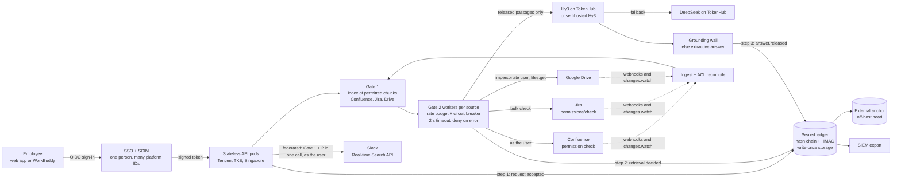

# Scale architecture: from mocks to real connectors

## 1. Start here: Slack's rules already point to our design

In May-June 2025 Slack changed its API terms. Apps may not bulk-export Slack data, keep persistent copies,
archives or indexes of it, or use API data in LLMs
([Slack changelog](https://docs.slack.dev/changelog/2025/05/29/tos-updates), [primary];
[National Law Review analysis](https://www.natlawreview.com/article/salesforce-locks-down-slack-data-time-review-your-slack-api-terms), [secondary]).
Slack's sanctioned path for AI is the **Real-time Search API** (`assistant.search.context`), called **as the
user**, so Slack itself enforces permissions at query time
([Slack RTS docs](https://docs.slack.dev/apis/web-api/real-time-search-api), [primary]).

**This is a strength for us, not a problem.** Our Gate 2 already asks each source, at answer time, whether
this person may open this passage, and denies on any error (`databridge_ib/gates.py`). Moving Slack to the
Real-time Search API turns Gate 1 and Gate 2 for Slack into one live call as the user, with no Slack index at
all. Glean made the same move: its Slack connector fetches messages live through the RTS API
([Glean docs](https://docs.glean.com/connectors/native/slack/setup/slack-rts-connector), [primary]).

Two caveats, said plainly:
- The terms need a legal reading for Aspire's case [verify].
- **Our demo indexes a mock Slack.** That is fine for synthetic data, and not how production Slack would work.

Atlassian moved the same way: points-based rate limits for Forge, Connect and OAuth apps, enforced from
2 Mar 2026 ([Atlassian docs](https://developer.atlassian.com/cloud/confluence/rate-limiting), [primary]).
The market is moving from "crawl everything into one index" to "ask the source, as the user, at query time".

## 2. Three stages

| Stage | Hosting | What is added | Monthly infra [estimate] |
|---|---|---|---|
| **Today (demo)** | Laptop (D-03). A hardened Lighthouse deploy kit exists (`deploy/lighthouse/`), not live | Mock Slack, Confluence, Jira and Drive with real API shapes (`databridge/apps/mock_platforms/`); Hy3 via TokenHub (international endpoint), pending activation | Lighthouse 2 vCPU / 4 GB is about US$6-8.50 list ([Tencent](https://www.tencentcloud.com/document/product/1103/47794)) |
| **Pilot** (≤100 users, 2 sources) | Tencent Cloud **Singapore region**, single tenant: one app VM, managed PostgreSQL, object storage for the sealed ledger and external anchor, KMS for keys and connector secrets | SSO (OIDC) + SCIM; real Confluence and Slack (internal app); per-tenant leak harness; monitoring | about US$150-400 |
| **Scale** (1,000-10,000 users) | Containers (TKE) behind a load balancer; stateless API pods; a Gate 2 worker pool per source with rate budgets; read replicas; ledger on write-once storage | Webhook and event ingestion; per-source circuit breakers; per-compartment kill switch; SIEM export of the ledger | about US$1-3k (US$0.30-1.00 per seat) |
| **Option: nothing leaves the tenant** | Self-host Hy3 open weights (Apache 2.0, 295B total / 21B active; [model card](https://huggingface.co/tencent/Hy3)) on GPU nodes | Removes the cross-border transfer question (PDPA s.26) | High fixed GPU cost; for large banks only [estimate] |

Infrastructure trust a Tencent Cloud Singapore deployment would build on (to confirm with Tencent; we are not deployed there): Tencent Cloud states MTCS Level 3 and an OSPAR attestation for products in its
Singapore region ([Tencent Cloud compliance](https://www.tencentcloud.com/document/product/363/34543), [primary]; confirm which products are in scope).

## 3. Production diagram

A copy of this diagram as a standalone file belongs in `docs/tencent/diagrams/` (owned by another agent).

## 4. Connector path: mock today, real tomorrow

| Source | Today (mock, real API shapes) | Production API and permission model | Limits that matter | What changes |
|---|---|---|---|---|
| **Slack** | Index of threads; Gate 2 uses `users.info`, `conversations.list`, `conversations.members`, `conversations.replies` (`databridge_ib/connectors/`) | Real-time Search API as the user (xoxp token) | Terms above. Non-Marketplace distributed apps: `conversations.history/replies` cut to 1 request/min and 15 objects; **internal customer-built apps keep 50+/min and 1,000 objects** ([Slack changelog](https://docs.slack.dev/changelog/2025/05/29/rate-limit-changes-for-non-marketplace-apps), [primary]) | **Federated: no Slack index.** Ship as an internal app in Aspire's own workspace. "Next-query revocation" holds by construction |
| **Confluence Cloud** | Compiles space permissions and page restrictions; Gate 2 = `POST /wiki/rest/api/content/{id}/permission/check` | Same check API; it needs a Confluence admin account. Alternative: per-user OAuth 2.0 (3LO) and CQL as the user | Points-based hourly quotas, HTTP 429 when exceeded ([Atlassian blog](https://www.atlassian.com/blog/platform/evolving-api-rate-limits), [primary]). One developer reports a single permission call near 1,000 points [verify] | Gate 2 only on the top-k after ranking; batch; apply for a higher tier; webhook-driven ACL recompile |
| **Jira Cloud** | Compiles "Browse projects" holders plus issue security levels | Bulk `POST /rest/api/3/permissions/check` with `accountId`; checking other users needs Administer Jira ([community thread](https://community.developer.atlassian.com/t/im-cannot-check-a-user-permission-from-specific-jira-project-via-rest-api/52682), [secondary]) | Same Atlassian points model | One bulk call per answer for all Jira candidates |
| **Google Drive** | Compiles `files/{id}/permissions` incl. inherited; fails closed on "anyone with link" and expiring grants | Service account with domain-wide delegation: impersonate the asker and `files.get` (404 = no access); `changes.watch` push channels ([Drive push docs](https://developers.google.com/workspace/drive/api/guides/push), [primary]) | Push notifications carry no body; channels expire (third-party: 1 h default, 7 days max [verify]) | Renew channels on a schedule; impersonation keeps Gate 2 "as the user" |
| **Identity** | Synthetic directory with per-platform IDs | SSO (Okta, Google or Entra) + SCIM | Unmapped identity = deny (built; `test_gate2_inactive_or_unmapped*` in each connector test) | Admin view of unmapped accounts |

Every connector already fails closed on 429, timeout and error (`test_mock_permission_check_needs_admin_and_429_denies`
in the Confluence and Jira tests; `test_mock_edit_drift_and_429` for Drive; `test_fail_closed` in `test_contracts.py`).

## 5. What breaks first at scale

**API quota, not model cost.** Say it before a judge does. The plan:

1. Gate 2 checks only the top candidates after ranking, never the whole result set.
2. Bulk checks where the API has them (Jira).
3. Federated Slack: one RTS call replaces index plus check.
4. Per-source rate budgets and circuit breakers. A slow source is left out of the answer, never guessed.
5. Measure Gate 2 p95 against real permissions in pilot weeks 2-4 (shadow mode).

Any cache of Gate 2 results must have a configurable bound, default 0, so that "revocation is honoured on the
next question" stays true (`test_s4_revocation_without_webhook`).
