# Architecture on one page

> **Status.** 30 Oct 2026. References: `databridge_ib/…` = `databridge/apps/internal_brain/databridge_ib/…`;
> `tests/…` = `databridge/apps/internal_brain/tests/…`. Line numbers from commit `e5406b9`
> (`git show e5406b9:<path>`); these files are being edited this week, so the function or test name is
> the stable part. Full detail: `docs/tencent/ARCHITECTURE.md`.

**In one sentence:** two permission checks run before any model sees a word, every step is written to a
sealed log before the next one starts, and every outcome comes back in the same shape.

## Diagram

```mermaid
flowchart LR
    U["Person<br/>web app :3100 or WorkBuddy (MCP)"] -- "question + signed token<br/>(TB1)" --> A["Brain API :8100<br/>identity from token only"]
    A --> L1[("① request.accepted")]
    L1 --> G1["Gate 1<br/>rank only what you may open<br/>stats over permitted docs only"]
    G1 --> G2["Gate 2<br/>ask each source live (TB3)<br/>2 s budget · error/timeout/429 = deny"]
    G2 --> L2[("② retrieval.decided")]
    L2 --> M["Model (TB4)<br/>Hy3 → DeepSeek → extractive<br/>no tools · ≤ 14 passages"]
    M --> W["Grounding wall<br/>values must be in cited evidence"]
    W --> L3[("③ answer.released")]
    L3 --> R["One response shape<br/>restricted ≡ does not exist"]
    S["Slack · Confluence · Jira · Drive<br/>mock :8200, real API shapes"] -- "signed webhooks + poller (TB6)" --> I[("Index<br/>masked text · compiled ACLs<br/>local embeddings")]
    I --> G1
    S --- G2
    L3 -. "head every 15 min (TB5)" .-> X[("External head<br/>separate repo / Slack")]

    classDef fail stroke:#c0392b,stroke-width:2px;
    class A,G2,L1,L2,L3 fail;
```

Boxes with a red border fail closed: if they cannot complete, the request stops (401, deny or 503).

## Request path: `POST /ib/ask`

| # | Step | Fails closed how | Code | Test |
|---|---|---|---|---|
| 1 | Verify the signed token (HMAC, ≤ 8 h, revocable). Body holds only `question`. | Bad token → 401; body naming a user → 422 | `databridge_ib/auth.py:34-63`; `databridge_ib/models.py:154-155` | `tests/test_app_routes.py::test_identity_from_token_only` |
| 2 | Ledger `request.accepted` | Write fails → 503, nothing retrieved | `databridge_ib/pipeline.py:106-110` | `tests/test_pipeline_core.py::test_write_ahead_fail_closed` |
| 3 | Gate 1: readable set; BM25 over permitted chunks only; relevance gate | Nothing relevant → constant refusal, no model call | `databridge_ib/pipeline.py:114-127`; `databridge_ib/index.py:289-316` | `tests/test_pipeline_core.py::test_p2_differential_world_with_and_without_restricted` |
| 4 | Gate 2: live check per candidate, one 2 s batch budget; re-read on version drift | Error, timeout, 429, missing connector → deny | `databridge_ib/gates.py:28-54`; `databridge_ib/pipeline.py:133-146` | `tests/test_scenarios_e2e.py::test_s4_revocation_without_webhook` |
| 5 | Ledger `retrieval.decided` (considered, verdicts, released) | Write fails → 503, no model call | `databridge_ib/pipeline.py:151-158` | `tests/test_pipeline_core.py::test_ledger_events_order` |
| 6 | Model over released passages only; chain Hy3 → DeepSeek → extractive | Any model failure → next model → extractive | `databridge_ib/llm.py:88-104` | `tests/test_llm_chain.py::test_both_fail_pipeline_serves_extractive` |
| 7 | Grounding wall; drop sentences addressed to an AI; require a valid citation | Violation → extractive | `databridge_ib/pipeline.py:163-179`; `databridge_ib/narrate.py:129-134` | `tests/test_llm_chain.py::test_ungrounded_number_refused_by_grounding_wall` |
| 8 | Ledger `answer.released` (model, prompt version, answer hash, citations, `stage_ms`) | Write fails → 503, no answer | `databridge_ib/pipeline.py:184-197` | `tests/test_app_routes.py::test_ledger_failure_is_503` |
| 9 | Respond: `request_id`, `answer`, `citations`, constant `scope_note`, `model`, `as_of` | — | `databridge_ib/models.py:179-185` | `tests/test_scenarios_e2e.py::test_s3_existing_vs_nonexistent_identical` |

## Trust boundaries

| ID | Boundary | Control | Limit |
|---|---|---|---|
| TB1 | Browser / MCP client → API | Signed token; closed schema; route allowlist (`databridge_ib/app.py:33, 244`); web proxy allowlist, same-origin POST, 64 KiB | Demo login stands in for SSO |
| TB2 | API → platforms (ingest) | Service-token reads; retries | Service accounts are super-readers |
| TB3 | API → platforms (Gate 2) | One attempt, 2 s budget, deny on failure | Correct only if the platform's check API is |
| TB4 | API → TokenHub | Released passages only; no tools | Provider retention not verified; Hy3 not yet live |
| TB5 | API → external head sink | Ids and hashes only; only a verified ledger is published | Default sink is a local file |
| TB6 | Platforms → webhooks | HMAC over `ts.delivery.body`, ±300 s, replay check; events only invalidate | Replay memory is per process |
| TB7 | WorkBuddy → API (MCP) | Per-persona token; no identity argument | WorkBuddy's own model is outside our ledger |
| TB8 | Remote embeddings | **Not enabled**: local embedder | Enabling it would send every chunk out |
| TB9 | Internet → Lighthouse edge | Caddy, TLS, body cap | **No live instance** |

Source: `docs/tencent/ARCHITECTURE.md:191-206`.

## Tencent products

| Product | Role | Status |
|---|---|---|
| TokenHub · Hunyuan Hy3 | Answer model (DeepSeek as backup) | Wired and tested with a capturing model; **not yet run live** (account verification pending) |
| WorkBuddy | Second front door via two MCP servers (ask, audit) | Built and used (`docs/tencent/ARCHITECTURE.md:41`) |
| CodeBuddy | Built the WorkBuddy connector and token tool; drew the trust boundaries; security review on Hy3 | Transcripts in `docs/tencent/DEV_PROCESS.md` |
| Lighthouse | Deploy kit (Caddy, Docker Compose, smoke script) | Written; no live instance (capacity sold out); demo runs on the laptop (`docs/finals/DECISIONS.md` D-03) |

## Developer views added 30 Oct

| Route | Who | Shows | Status |
|---|---|---|---|
| `answer.released.stage_ms` | ledger | accept, gate1, gate2, seal, compose timings | Built (`databridge_ib/pipeline.py:185-188`) |
| `GET /ib/trace/{req_id}` | the asker, own requests only | Stages, timings, model, released, cited, record hashes; never the considered set or reason codes | Built (`databridge_ib/app.py:176-203`) |
| `GET /audit/journey/{req_id}` | compliance | The full journey incl. Gate 2 verdicts; no answer text | Built (`databridge_ib/audit/routes.py:249-264`) |
| `GET /audit/stats` | compliance | Counts, timings, distributions only | Built (`databridge_ib/audit/routes.py:224-247`; `databridge_ib/audit/stats.py`) |
| `GET /ib/graph`, `GET /ib/doc/{id}` | any employee | Permission-aware graph and document view | **In progress** (`docs/finals/PLAN.md` §5, B5-B6) |

Tests for the built routes: `tests/test_dev_views.py` (6 tests).

## What is mocked

The four platforms (mock servers with real API shapes, permission models, webhooks, errors and rate
limits); sign-in (demo login, not SSO); the model on every measured number (capturing fake model, plus the
deterministic extractive path); the data (synthetic Company A). The connector code is the same for mock and
real: only the base URL changes (`databridge_ib/config.py:36-38`; `docs/tencent/ARCHITECTURE.md:51-53`).
