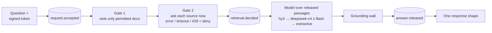
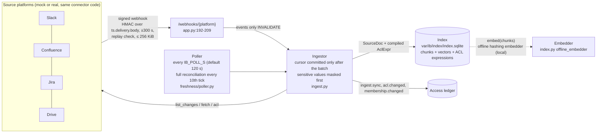

# Walnut Internal Brain: architecture

> FinTech Track (Aspire), "The Internal Brain". Sections 1 to 7: status as of 15 Oct 2026; section 8
> (developer views) added 30 Oct 2026 for the finals build. Code references were re-checked
> against commit `8e66591`; line numbers can drift, so the function or test name is the stable part.
> Paths are relative to `databridge/apps/internal_brain/databridge_ib/` unless they start with
> `databridge/`, `deploy/`, `tests/` (= `databridge/apps/internal_brain/tests/`) or `docs/`.

The Internal Brain answers an employee's question from Confluence, Jira, Slack and Google Drive, using
only what that employee can open in the source system at that moment. Two permission gates run before
any model sees text. **Gate 1** ranks only the documents the stored source permissions allow, with search
statistics computed over those documents alone. **Gate 2** then asks each source, live, whether this
person may open each candidate now; an error, a timeout or a rate limit counts as "no". Every request
writes three audit events in order (`request.accepted`, `retrieval.decided`, `answer.released`), and if
any write fails the request stops with a 503. The model's draft passes Walnut's grounding wall, and every
outcome, including "restricted" and "does not exist", comes back in the same shape.

The full picture, with the trust boundaries marked, is
[`diagrams/trust_boundaries.mmd`](diagrams/trust_boundaries.mmd) (legend in
[`diagrams/README.md`](diagrams/README.md)). What data leaves the host, and what is kept, is in
[DATA_FLOWS.md](DATA_FLOWS.md).

## 1. Components

| Component | Code | Port | Role |
|---|---|---|---|
| Internal Brain API | `databridge/apps/internal_brain/databridge_ib/` (`python -m databridge_ib`) | 8100 | Sign-in, ask pipeline, knowledge map, ingest, webhooks, audit, demo simulator |
| Mock platforms | `databridge/apps/mock_platforms/` (`python -m mock_platforms`) | 8200 | Slack, Confluence, Jira and Drive APIs for a supported subset, with native permission semantics and signed webhooks |
| Web app (Walnut DataBridge) | `databridge/apps/internal_brain_web/` (Next.js 14) | 3100 | User mode (sign-in, Ask, Compare, History, Settings, Value) and Developer mode (Mission control, Journey, Knowledge graph, Walnut engine, Analytics, Audit, Simulator, Trust centre; section 8), Presenter mode and tours, and a same-origin proxy to the API |
| WorkBuddy MCP servers | `mcp_server.py` (`walnut-internal-brain`), `audit_mcp_server.py` (`walnut-ib-audit`) | stdio | Thin clients of `/ib/*` and `/audit/*`. Identity comes only from the `IB_TOKEN` bearer token; no tool takes an identity argument. Setup: [workbuddy/README.md](workbuddy/README.md) |
| Deploy kit | `deploy/lighthouse/` | 80, 443 | Caddy edge plus Docker Compose for a Tencent Lighthouse VM. Written and smoke-scripted; **no live instance** (Lighthouse capacity was sold out). See [deploy/lighthouse/README.md](../../deploy/lighthouse/README.md) |

**A separate app with its own state.** The Brain keeps all runtime state under `var/ib/` (`config.py:33,
70-101`). It reuses Walnut by import only and never imports the legacy gateway's routes: `grounding.py`
loads the grounding wall from its file (`tests/test_contracts.py::test_grounding_loads_without_legacy_gateway`).
Only `/health`, `/auth/*`, `/ib/*`, `/webhooks/*`, `/audit/*` and `/sim/*` may exist (`app.py:33`). The app
refuses to start if any other route is mounted (`app.py:215-217`;
`tests/test_app_routes.py::test_only_allowlisted_routes`). The OpenAPI and docs routes are off (`app.py:83`).

**Same connector code for mock and real.** Connectors reach the platforms through an injected
`httpx.Client` whose base URL is either the mock or a real service (`connectors/base.py:1-16`,
`bootstrap.py:39-51`). The mock is a stand-in, not a fork.

**The web proxy** (`databridge/apps/internal_brain_web/app/api/ib/[...path]/route.ts`) is the browser's
only way to the API:

1. A closed allowlist of method and path pairs; `/webhooks` is not on it. Path segments must be plain
   names, and the outbound URL is checked again after URL parsing.
2. POSTs must pass a same-origin check (`Origin` and `Sec-Fetch-Site`), carry JSON only, and be at most
   64 KiB.
3. Only the `ib_session` cookie is forwarded upstream and relayed back (`HttpOnly`, `Path=/`), so no
   token is visible to JavaScript. Upstream 5xx bodies are replaced by a fixed message.
4. The Compare page signs two personas in side by side through slot cookies `ib_session_b` and
   `ib_session_c`, chosen by an `x-ib-slot` header. Slots reach only sign-in, whoami, ask and map, never
   `/audit` or `/sim`. The page holds Web Locks on the slots
   (`databridge/apps/internal_brain_web/lib/api.ts`, `withSlotLocks`) so two
   Compare tabs cannot swap a slot's person mid-comparison.

**Main modules of the API**

| Module | Job |
|---|---|
| `pipeline.py` | The ask pipeline, in the binding order of section 2 |
| `index.py` | SQLite index of chunks, vectors and compiled permissions; Gate 1 (`readable`) and ranking (`search`) |
| `gates.py` | Gate 2: parallel live checks with one 2 s budget per batch |
| `acl.py`, `connectors/` | Permission expressions, and one connector per platform (crawl, fetch, permissions, live check, webhooks) |
| `ingest.py`, `freshness/poller.py` | Ingestion from crawls, webhooks and the poll fallback |
| `narrate.py`, `llm.py`, `grounding.py` | Prompt and context format, model chain, Walnut's grounding wall |
| `knowledge_map.py` | `GET /ib/map`: what one person can open, each item re-checked live |
| `audit/` | Access ledger, answer content store, external head, query projection, audit routes |
| `auth.py`, `sensitive.py`, `sim.py` | Signed tokens and revocation; card/NRIC/IBAN masking at ingest; the admin simulator |

## 2. Request path, step by step: `POST /ib/ask`

The order is binding and is implemented in `Pipeline.ask` / `Pipeline._ask` (`pipeline.py:83-192`); the
step numbers match the comments in that file.

| Step | What happens | Code | Test |
|---|---|---|---|
| 1. Sign-in check | Identity comes only from a signed token (cookie `ib_session` or `Authorization: Bearer`): HMAC over `{sub, roles, exp ≤ 8 h, aud, jti}`, checked against a revocation list. The directory user must be active and hold an employee role. The body is a closed schema holding only `question` (1 to 2000 characters). | `app.py:52-70, 138-151`; `auth.py` `verify`; `models.py:24-25, 154-155` | `tests/test_app_routes.py::test_identity_from_token_only`, `::test_bad_and_expired_tokens` |
| 2. Ledger `request.accepted` | Written before anything is retrieved. If the write fails, nothing is retrieved and the caller gets a 503. | `pipeline.py:106-110` | `tests/test_pipeline_core.py::test_write_ahead_fail_closed` |
| 3. Time window | Deterministic parsing ("last week", "last quarter"). The window is a ranking preference, and time phrases are removed from the search terms. | `pipeline.py:111-113`; `timewin.py` | |
| 4. Gate 1 | `readable(user)` evaluates the stored permission expressions. Only those documents are ranked. BM25 statistics (document frequency, average length) come from the asker's permitted chunks only, so restricted documents cannot shift a score. | `pipeline.py:114-117`; `index.py` `readable`, `search` (`index.py:289-316`) | `tests/test_pipeline_core.py::test_p2_differential_world_with_and_without_restricted` |
| 5. Relevance gate | A passage counts only if it covers enough of the question's IDF-weighted terms (0.5 for a one-part question, 0.4 per part of a multi-part one, 0.6 for a 3+ term part with no matching word pair) or names an exact identifier. It is applied before the top-k cut. Nothing relevant means no Gate 2 call, no model call and the constant refusal. | `index.py:37-42, 374-380`; `pipeline.py:116-117, 158-159` | `tests/test_pipeline_core.py::test_s3_contractor_refusal_is_the_constant` |
| 6. Gate 2 | Each candidate document's source is asked now, in parallel, with one 2 s budget for the whole batch. A missing connector, an exception, a timeout or a 429 is a deny; there is no cache on this path. Denied documents also leave the ranking pool. | `gates.py` `check_all`; `pipeline.py:131-137` | `tests/test_pipeline_core.py::test_s4_revocation_at_source_wins_over_stale_index`; `tests/test_scenarios_e2e.py::test_s4_revocation_without_webhook` |
| 6a. Version drift | A document whose source version moved on is re-fetched, masked and re-indexed. It is admitted only if the fresh permissions still admit the asker and the fetched version is the one Gate 2 checked. | `Pipeline._read_through` (`pipeline.py:201-233`) | `tests/test_pipeline_core.py::test_drift_read_through` |
| 7. Linked objects | Links in released documents are resolved only within the asker's readable set (up to 4), then go through Gate 2 again. Depth 1. | `pipeline.py:138-144, 264-285` | |
| 8. Ledger `retrieval.decided` | Records the documents considered (id, platform, container, title), each Gate 2 verdict and reason, and the documents released. Written before any model call. | `pipeline.py:148-155` | `tests/test_pipeline_core.py::test_ledger_events_order` |
| 9. Generate | Only released passages reach a model (section 6). | `pipeline.py:156-162`; `llm.py` `ModelChain.answer` | `tests/test_pipeline_core.py::test_p1_restricted_never_in_any_prompt` |
| 10. Ground | Walnut's grounding wall checks the draft. A model answer is used only if it is the refusal or cites at least one released passage; otherwise the deterministic extractive answer is served. | `pipeline.py:163-175`; `narrate.py` `IbGroundedNarrator` | `tests/test_llm_chain.py::test_ungrounded_number_refused_by_grounding_wall` |
| 11. Ledger `answer.released` | Records the model, prompt version, answer hash, citations and the count of dropped sentences. The answer text goes to a separate content store. Written before the response. | `pipeline.py:180-189` | `tests/test_app_routes.py::test_ledger_failure_is_503` |
| 12. Respond | One shape for every outcome: `request_id`, `answer`, `citations`, a constant `scope_note`, `model`, `as_of`. A refusal, a restricted document and a document that never existed look the same. | `models.py:179-185`; `pipeline.py:190-192` | `tests/test_scenarios_e2e.py::test_s3_existing_vs_nonexistent_identical` |

**Failure.** Any exception in the pipeline appends a best-effort `request.failed` event holding the error
class only, and the API returns 503 "temporarily unavailable" (`pipeline.py:83-97`, `app.py:147-151`).

**Search breadth.** The index returns the top 12 relevant hits (`config.py:20`). A question that names a
platform word ("Slack", "ticket", "runbook") gets up to 4 more hits from that platform's readable
documents (`pipeline.py:37-51, 119-125`). After Gate 2 the pool is re-ranked over the asker's full
permitted set, with at most two chunks per document, interleaved across platforms, and capped at 14
passages (`pipeline.py:33-35, 145, 235-262`).

**The knowledge map follows the same rules** (`GET /ib/map`, `knowledge_map.py`). Gate 1 picks the
candidates, and Gate 2 re-checks every item live on its own 8-worker pool with a 45 s batch budget, so the
map's checks never queue ahead of an answer's. Unconfirmed items are left out. The view is ledgered as `map.viewed` before anything is
returned, and only titles leave, never document text (`tests/test_knowledge_map.py`: lists only what the
caller can open; identical with and without restricted documents; no map when the ledger is down; a
revocation with a lost webhook is honoured).

## 3. Ingestion path

- **Events invalidate; they never carry truth.** A verified webhook makes the connector re-fetch the
  document and its permissions (`ingest.py:1-5`, `connectors/base.py:12-13`). A `user.changed` event only
  invalidates cached readable sets; Gate 2 asks the source about the user on every query
  (`ingest.py:113-116`).
- **Permissions are policy expressions**, compiled by each connector from the platform's native model and
  evaluated per person at query time (`acl.py` `allows`, lines 36-54). Anything outside a connector's
  supported subset compiles to `nobody` (fail closed). The subset per platform is in each connector's
  module docstring: `connectors/slack.py:1-27`, `connectors/confluence.py:1-31`, `connectors/jira.py:1-43`,
  `connectors/drive.py:1-51`.
- **Two HTTP disciplines.** Ingest retries a 429 (honouring `Retry-After`) and 5xx errors; Gate 2 makes
  exactly one attempt with a hard timeout (`connectors/_http.py:1-8`).
- **Embeddings are local.** `bootstrap.py:63` builds the index with the default embedder, the offline
  hashing embedder (`index.py` `offline_embedder`, lines 159-161, 168), so no chunk leaves the host at
  ingest. A TokenHub embedding alias exists in the model config (`llm.py:33-37`) but is not wired into the
  index.
- **Sensitive values are masked before indexing** (feature F4). The ingestor and the drift read-through
  call `sensitive.py` `mask_doc` before every index write (`ingest.py:63-64, 102`; `pipeline.py:224`):
  Luhn-valid card numbers to first 6 + last 4, card security codes, Singapore NRIC/FIN and mod-97-valid
  IBANs. The rules are data in `databridge/packs/enterprise/sensitive.yaml`
  (`tests/test_sensitive.py`; `tests/test_fintech_scenarios.py::test_sens_raw_values_appear_nowhere_in_the_index`).
- **Freshness** per platform is served at `GET /ib/sources` with `lag_s` (time since the last successful
  sync) and `within_slo` (`app.py:176-189`). The target is 300 s on the mock and 900 s live
  (`config.py:16-17`).

## 4. Audit path

| Piece | Code | What it does |
|---|---|---|
| Access ledger | `audit/ledger.py` | A thin wrapper over Walnut's `DecisionLedger` (`databridge/packages/core/databridge_core/decision_ledger.py`): sealed, hash-chained JSONL with an internal anchor ledger in a separate directory. Any failure raises `LedgerUnavailable` (`AccessLedger.append`), which callers turn into a 503. |
| Content store | `audit/content.py` | The only place answer text lives (`var/ib/content/answers.sqlite`). One row per request; re-hashed on read against the sealed `answer_sha256`. |
| External head | `audit/anchor.py` | Publishes `{log_id, seq, head, at}` of the verified ledger to a sink (`FileSink` for a separate git repo, or a Slack webhook with a file mirror) and ledgers `anchor.published`. Runs at startup and every `IB_ANCHOR_INTERVAL_S`, default 900 s (`bootstrap.py:85-137`, `config.py:46`). |
| Projection | `audit/query.py` | A derived SQLite view, re-synced from the verified ledger before every audit read. Holds no answer text. |
| NL filter | `audit/nl_filter.py` | Deterministic parser from a question to a closed `AuditFilter`. An optional model sees only the question and the clock; none is wired by default. |
| Routes | `audit/routes.py` | `compliance_officer` only. `GET /audit/events`, `GET /audit/doc/{id}/accessors`, `POST /audit/ask`, `POST /audit/reveal` (a reason is required, and `audit.reveal` is ledgered before the text is read), `GET /audit/verify`. Each call is ledgered before the response; failed calls are ledgered too. |
| Audit MCP | `audit_mcp_server.py` | The same audit routes for WorkBuddy, under the compliance officer's own token. |

Two limits, both stated in `audit/routes.py:10-19`. Requests the framework rejects before a handler runs
(no token, a malformed body) are not ledgered. `/audit/verify` still returns its report, which holds
counts and hashes only, with `"ledgered": false` when the ledger refuses the append, because that is when
an officer needs it.

**Ledger events** (`models.py:192-194`, `EVENT_KINDS`):

| Event | Written when | Holds |
|---|---|---|
| `request.accepted` | Before retrieval | Who, channel (`ui` or `workbuddy-mcp`), question and its hash, policy version |
| `retrieval.decided` | Before any model call | Documents considered (id, platform, container, title), Gate 2 verdicts and reasons, documents released |
| `answer.released` | Before the response | Model, prompt version, answer hash and content-store key, refused flag, citations, dropped-sentence count, latency |
| `request.failed` | On any pipeline exception (best effort) | Error class only |
| `map.viewed` | Before the map is returned | Counts of items and containers listed |
| `auth.login` | Before a session cookie is issued | Who, method, roles |
| `audit.query`, `audit.reveal` | Before an audit response | The filter and result count; or the reveal target and reason |
| `ingest.sync`, `acl.changed`, `membership.changed`, `anchor.published` | On sync, permission change and head publication | Ids and counts, never content |

## 5. Trust boundaries

The diagram is [`diagrams/trust_boundaries.mmd`](diagrams/trust_boundaries.mmd) (drawn in a CodeBuddy
Plan-mode session, then corrected against the code). It marks TB1 to TB5; this table is the fuller list.

| ID | Boundary | What crosses it | Control | Evidence | Limit |
|---|---|---|---|---|---|
| TB1 | Browser or MCP client → IB API | Question text; session token | Signed token (HMAC, `aud=ib`, `exp` ≤ 8 h, `jti` revocation list that fails closed); closed request schema; enforced route allowlist. The browser reaches the API only through the web proxy (closed allowlist, same-origin check, JSON ≤ 64 KiB, only `ib_session` relayed). The MCP servers run beside the API and send the token as a bearer header. | `auth.py`; `app.py:33, 52-70, 215-217`; `databridge/apps/internal_brain_web/app/api/ib/[...path]/route.ts`; `tests/test_app_routes.py` | `/auth/demo-login` lets a caller pick a persona when `IB_DEMO_LOGIN=1`, gated by `IB_DEMO_PASSCODE` when set, and a deployed build refuses to start without a passcode of 8+ characters (`app.py:92-113`, `config.py` `assert_deployable`). No real SSO (roadmap). |
| TB2 | IB → source platforms (ingest) | Service-token reads of all content and permissions | The service client is used for reads; ingest retries, Gate 2 does not (`connectors/_http.py:1-8`) | e.g. `tests/test_connector_slack.py::test_crawl_retries_429_honouring_retry_after` | The service and admin clients are super-readers (MAS TRM §9.2.2 trade-off, [MAS_TRM_MAPPING.md](MAS_TRM_MAPPING.md)). Real Confluence and Jira permission checks need admin rights. |
| TB3 | IB → source platforms (Gate 2) | A `(user, doc)` permission question at answer time | One attempt, 2 s batch budget, any failure ⇒ deny | `gates.py`; `tests/test_connector_{confluence,jira,drive}.py::test_gate2_failures_deny_without_retry`; `tests/test_connector_slack.py::test_gate2_any_source_failure_denies_without_retry` | Correctness depends on the platform's own check API. Jira's bulk permission check has a recorded incorrect-result bug, [JRACLOUD-84541](https://jira.atlassian.com/browse/JRACLOUD-84541). |
| TB4 | IB → TokenHub (generation) | System prompt + released passages + question, per request | Only Gate-2-released passages are sent; the model has no tools | `pipeline.py:156-162`; `tests/test_pipeline_core.py::test_p1_restricted_never_in_any_prompt` | Provider-side retention not verified by us ([DATA_FLOWS.md](DATA_FLOWS.md)). Hy3 is configured but has not yet been called live (TokenHub account verification pending). |
| TB5 | IB → external anchor sink | `{log_id, seq, head, at}` only, no content | Publish only a verified ledger; a sink failure records nothing | `audit/anchor.py`; `tests/test_audit_tamper.py::test_publish_refuses_broken_ledger`, `::test_slack_sink_posts_and_failure_records_nothing` | The default sink is a local file (`bootstrap.py:85-97`); it is off-host only if `IB_ANCHOR_FILE` sits in a separately pushed repo or `IB_ANCHOR_SLACK_WEBHOOK` is set. |
| TB6 | Platforms → IB webhooks | Change notifications (ids only) | HMAC-SHA256 over `timestamp.delivery_id.body`, ±300 s window, replayed delivery id rejected, 256 KiB cap; events only invalidate | `connectors/_http.py` `sign_webhook`, `WebhookVerifier` (lines 204-258); `app.py:192-209`; `tests/test_connector_slack.py::test_webhook_rejects_bad_signature_stale_and_replay` | The replay set is in memory: lost on restart, though the ±300 s window still applies. |
| TB7 | WorkBuddy and its model provider → IB (MCP) | A WorkBuddy agent's tool call carrying a per-persona token | A thin stdio MCP client of `/ib/*` with no identity argument; one connector per persona. The `workbuddy-mcp` channel label is honoured only on bearer calls (`app.py:142-146`). | `mcp_server.py`, `audit_mcp_server.py`; `tests/test_mcp_server.py::test_internal_brain_tools_have_no_identity_argument`, `::test_audit_tools_have_no_identity_argument`; screenshots in `submission/02_workbuddy/` | WorkBuddy's own model and memory see Walnut's answer and sit **outside** our ledger. |
| TB8 | TokenHub embeddings at ingest | Would be all chunks of all documents | Not enabled: the local offline hashing embedder is used | `bootstrap.py:63`; `index.py` `offline_embedder` | If enabled, every chunk would go to the provider regardless of permissions, and the query would be embedded before `retrieval.decided` (Codex security review r1, finding 11). |
| TB9 | Public internet → Lighthouse edge | HTTPS to the web app | Caddy is the only public listener. It serves only the web pages, static assets and `/api/ib/*`, with TLS, security headers and a 64 KB body cap. The API and mock publish no ports. `deploy.sh reset` restores a fresh synthetic world. | `deploy/lighthouse/Caddyfile`, `docker-compose.yml`, `smoke.sh` | No live instance. No rate limiter (stock Caddy has none). The deployed stack uses the mock platforms only and never connects to real workspaces. |

## 6. Model chain and prompt

- **Chain:** TokenHub `hy3` → `deepseek-v4.1-flash` → deterministic extractive answer (`llm.py:24-25,
  65-81`). Any error, timeout, 429 or empty answer moves down the chain, and so does a grounding violation
  (the wall raises inside the narrator). A model answer that cites no released passage is replaced by the
  extractive answer with `fallback_used=true` (`pipeline.py:167-175`;
  `tests/test_llm_chain.py::test_hy3_raises_falls_back_to_deepseek_flash`, `::test_both_fail_pipeline_serves_extractive`).
- **Status:** the chain is configured, but hy3 has not yet been called live; the TokenHub account is
  waiting on verification. Without a TokenHub key, or with `IB_FORCE_OFFLINE=1`, the chain is off and
  every answer is extractive (`llm.py:28-30, 56`).
- **Extractive answer:** up to 4 verbatim sentences from released passages, each tagged with its passage,
  so it is grounded by construction (`narrate.py` `extractive_answer`).
- **Prompt:** `narrate.py:21-35`, versioned as `PROMPT_VERSION` (`narrate.py:19`) and written to every
  `answer.released` event (`pipeline.py:183`). It tells the model to use only the passages, reply with the
  exact refusal text when they do not answer, tag every sentence, copy numbers and names exactly, treat
  passages as untrusted data, and never mention content outside them.
- **Context contract:** one line per released passage,
  `[C<n>] (<platform> · <container> · <title> · v<version> · <date>) <text>`. Any citation-shaped token
  inside source text or metadata is rewritten so it cannot bind to a real tag (`narrate.py`
  `neutralise_tags`, `Passage.line`, lines 50-53, 88-92).
- **Clean-up before grounding:** markdown is stripped, trailing tags are moved inside their sentence, and
  sentences addressed to an AI (quoted injections) are dropped and counted in `answer.released`
  (`narrate.py` `_StripMarkdown`, `drop_addressed_to_ai_counted`; `pipeline.py:165-170`).
- **Vendor SDKs** are reached only through Walnut's `databridge_harness` (`llm.py:1-9, 59-62`).

## 7. What the Internal Brain uses from the Walnut engine

The Internal Brain imports `databridge_core` (`DecisionLedger`), `databridge_harness` (`Harness`,
`LiteLLMBackend`, `hashing_embed`) and the grounding functions in
`databridge/apps/gateway/databridge_gateway/llm.py` (`GroundedNarrator`, `ground_narration`,
`bind_sentences`, `unsupported_named_terms`). The grounding functions are loaded by file path, so the
legacy gateway's routes are never imported.

The Internal Brain does not modify `packages/core`, `packages/harness`, `packages/retrieval`,
`packages/adapter` or `apps/gateway`; it uses them by import.

## 8. Developer views and their guarantees

Added for the finals (30 Oct 2026, branch `final_v1.0`). The web app now has a Developer mode
(`/dev/*`). Every view in it reads from the same service and keeps the rules of sections 1 to 6. The full
security record, with limits, is [SECURITY.md §15](SECURITY.md#15-developer-views-and-the-finals-v2-additions-30-oct);
the endpoint contracts are [docs/finals/contracts/backend_v1.md](../finals/contracts/backend_v1.md).
Paths are relative to `databridge/apps/internal_brain/databridge_ib/`; tests are in `tests/`.

| # | View | Guarantee | Code | Test |
|---|---|---|---|---|
| 1 | **Trace receipt** (`GET /ib/trace/{req}`, any employee) vs **compliance journey** (`GET /audit/journey/{req}`, `compliance_officer`) | The receipt covers the asker's OWN requests only (another person's request and an unknown id are the same 404). It shows stage names ticked from the sealed records, the total time rounded to 100 ms, the model, per-request record hashes, and only the cited sources the asker can still open now. It never shows the considered set, Gate-2 verdicts or reason codes. The journey shows any request with millisecond stage timings, every Gate-2 verdict and reason, and the three sealed records with their sequence numbers; never the answer text. Both are ledgered | `app.py` (`/ib/trace`), `audit/routes.py` (`/journey`) | `test_dev_views.py::test_trace_is_own_requests_only_and_hides_gate2_reasons`, `::test_journey_is_compliance_only_and_has_no_answer_text`; `test_graph_doc.py::test_trace_lists_only_cited_docs_still_openable` |
| 2 | **Knowledge graph and document view** (`GET /ib/graph`, `POST /ib/graph/openable`, `GET /ib/doc/{id}`) | One version-bound helper, `authz.authorize`, decides every read outside the ask: Gate 1, then a live Gate 2 against the indexed version, read-through on drift, then a snapshot of whitelisted fields. Any error, timeout or 429 is a deny. The graph is drawn only from documents that passed in this call, with no hidden-neighbour counts unless exact. A restricted, unknown or failed document is the same 404. "Compare two people" is two separately signed-in graphs, with no union or greyed placeholders. `graph.viewed` and `doc.viewed` are written before anything is returned | `authz.py` (`authorize`, `VIEW_POOL`), `graph.py`, `docview.py` | `test_graph_doc.py::test_graph_is_identical_with_and_without_restricted_docs`, `::test_graph_hidden_counts_are_exact_or_absent`, `::test_doc_restricted_and_unknown_are_the_same_404`, `::test_graph_ledger_down_is_503` |
| 3 | **SSE stage events** (`POST /ib/ask/stream`) | The same pipeline call as `/ib/ask`. Events carry only a stage name from a fixed list (`pipeline.STAGES`: accepted, gate1, gate2, sealed, composing, grounded, released) and `ok`. Every successful request sends all seven in the same order, so a restricted and a made-up question give identical sequences. The answer text is sent once, after `released`, and equals the `/ib/ask` response | `app.py` (`/ib/ask/stream`), `pipeline.py` (`Pipeline.ask(on_stage=...)`) | `test_ask_stream.py` |
| 4 | **Tamper demo on a copy** (`POST /audit/tamper-demo`, `compliance_officer`) | The attack scenarios of `scripts/tamper_demo.py` run on a temporary copy of the live log, its anchors and the external head, taken under the append lock. Afterwards the endpoint checks that every byte the live files held at copy time is unchanged (`real_log_modified: false`) and deletes the copy. Ledgered write-ahead; one run at a time | `audit/tamper.py`, `audit/routes.py` (`/tamper-demo`) | `test_tamper_demo_route.py` |
| 5 | **Walnut engine proxy** (`/api/walnut/*` in the web app, for `/dev/brain`) | Off unless `WALNUT_PROXY=1`, always off when `IB_DEPLOYED=1`. GET only, on a closed allowlist of read paths with per-path query rules; never `/brain/query`, `/brain/ingest` or any write. Loopback Host and same-origin only. Needs a valid Internal Brain session for the persona the engine graph was built for (`jdoe`) or a compliance officer; everyone else gets 403. The gateway token stays server-side, and no browser cookie or upstream header is passed through | `databridge/apps/internal_brain_web/app/api/walnut/[...path]/route.ts` | `databridge/apps/internal_brain_web/tests/e2e/engine-proxy.spec.ts` |

Other finals endpoints: `GET /ib/status` (model ids and booleans, never a key) and `GET /audit/stats`
(compliance-only counts and timings over a half-open window, cached per verified ledger head). Both are in
SECURITY.md §15.3 and §15.4.
