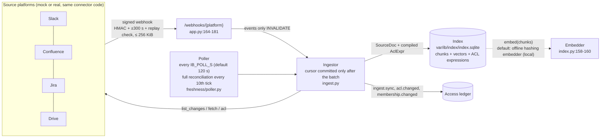

# Walnut Internal Brain: architecture

> FinTech Track (Aspire), "The Internal Brain". Status as of 15 Oct 2026; `file:line` references were
> taken at commit `4d1887e` and may have drifted by a few lines since. Paths are relative to `databridge/apps/internal_brain/databridge_ib/` unless they start
> with `databridge/`, `tests/` (= `databridge/apps/internal_brain/tests/`) or `docs/`. Where a component is
> planned but not yet in the repo, this page says so.

## 1. Shape of the system

| Process | Code | Port | Role |
|---|---|---|---|
| Internal Brain API | `databridge/apps/internal_brain/databridge_ib/` (`python -m databridge_ib`) | 8100 | Auth, ask pipeline, ingest, webhooks, audit, demo simulator |
| Mock platforms | `databridge/apps/mock_platforms/mock_platforms/` (`python -m mock_platforms`) | 8200 | Slack, Confluence, Jira and Drive APIs for a supported subset, with native permission semantics and signed webhooks |
| Web UI | `databridge/apps/internal_brain_web/` (Next.js) | 3100 | Login, Ask, Map, Compare, Audit console, Admin simulator, guided tour; a same-origin proxy with a closed path allowlist (`app/api/ib/[...path]/route.ts:1-24`) |

The Brain is a **separate app with its own state** under `var/ib/` (`config.py:33, 61-91`). It reuses Walnut
by import only and never imports the legacy gateway's routes: `grounding.py:1-33` loads the grounding wall
from its file (`tests/test_contracts.py::test_grounding_loads_without_legacy_gateway`). Only `/health`,
`/auth/*`, `/ib/*`, `/webhooks/*`, `/audit/*` and `/sim/*` may exist (`app.py:32`). The app refuses to build
if any other route is mounted (`app.py:187-189`), and `tests/test_app_routes.py::test_only_allowlisted_routes`
checks it. The OpenAPI and docs routes are off (`app.py:82`).

Connectors talk to the platforms through an injected `httpx.Client`. Its base URL is either the mock or a
real service, so the mock is a stand-in, not a fork (`connectors/base.py:1-16`, `bootstrap.py:39-51`).

## 2. Request path: `POST /ib/ask`

The order is binding. It is implemented in `pipeline.py:82-188`; the step numbers below match the comments
in that file.

```mermaid
flowchart TD
    U[User: browser cookie or MCP bearer token] --> A1
    A1["1 AuthN<br/>HMAC token: sub, roles, exp ≤ 8h, aud, jti<br/>app.py:51-69, auth.py"] --> L2
    L2["2 LEDGER request.accepted<br/>fail ⇒ 503, nothing retrieved<br/>pipeline.py:105-109"] --> P3
    P3["3 Parse time window<br/>deterministic; time phrases removed from search terms<br/>pipeline.py:110-112, timewin.py"] --> G1
    G1["4 GATE 1<br/>readable(user) from stored ACL expressions<br/>rank ONLY permitted chunks<br/>pipeline.py:113-116, index.py:288-379"] --> R5
    R5{"5 Relevance gate<br/>IDF coverage ≥ 0.4 or exact id,<br/>applied before top-k<br/>index.py:37-41, 374-377"}
    R5 -- nothing relevant --> L8
    R5 -- candidates --> G2
    G2["6 GATE 2<br/>ask the SOURCE now, per doc, in parallel<br/>2 s batch budget; error/timeout/429 ⇒ deny<br/>gates.py; read-through on version drift"] --> K7
    K7["7 Linked objects<br/>supported id shapes on tenant hosts,<br/>resolved only within the readable set<br/>re-enter Gate 2, depth 1<br/>pipeline.py:137-143, 260-281"] --> L8
    L8["8 LEDGER retrieval.decided<br/>considered, gate2 verdicts, released<br/>pipeline.py:147-154"] --> M9
    M9["9 GENERATE over released passages only<br/>hy3 → deepseek-v4.1-flash → extractive<br/>llm.py, narrate.py"] --> W10
    W10["10 GROUND<br/>markdown strip + Walnut grounding wall;<br/>answer must cite a released passage<br/>else extractive"] --> L11
    L11["11 LEDGER answer.released<br/>model, prompt_version, answer_sha256, citations<br/>answer text → separate content store<br/>pipeline.py:176-185"] --> R12
    R12["12 RESPOND<br/>one shape for every outcome<br/>answer, citations, scope_note, model, as_of"]
```

| Step | What it guarantees | Code | Test |
|---|---|---|---|
| 1 | Identity comes only from a signed token; bodies are closed schemas | `app.py:51-69`, `auth.py:45-80`, `models.py:24-25, 154-155` | `tests/test_app_routes.py::test_identity_from_token_only`, `::test_bad_and_expired_tokens` |
| 2, 8, 11 | Write-ahead: no retrieval without `request.accepted`, no model call without `retrieval.decided`, no response without `answer.released`. Any exception appends a best-effort `request.failed` (error class only) and becomes a 503. | `pipeline.py:84-96, 105-185`; `app.py:134-138` | `tests/test_pipeline_core.py::test_write_ahead_fail_closed`, `::test_ledger_events_order`; `tests/test_app_routes.py::test_ledger_failure_is_503` |
| 4 | Restricted chunks are never scored; BM25 statistics come from the asker's permitted corpus | `index.py:300-321` | `tests/test_pipeline_core.py::test_p2_differential_world_with_and_without_restricted` |
| 5 | Nothing relevant ⇒ the constant refusal, no model call | `pipeline.py:115-116, 157-158`; `index.py:376-377` | `tests/test_pipeline_core.py::test_s3_contractor_refusal_is_the_constant` |
| 6 | The source decides now; there is no cache on this path. Documents Gate 2 denies are also removed from the ranking pool. | `gates.py:1-50`; `pipeline.py:130-136` | `tests/test_pipeline_core.py::test_s4_revocation_at_source_wins_over_stale_index`; `tests/test_scenarios_e2e.py::test_s4_revocation_without_webhook` |
| 6 (drift) | A document whose source version moved on is re-fetched and re-indexed, and admitted only if the fresh policy still admits the asker and the fetched version is the one Gate 2 checked | `pipeline.py:197-228` | `tests/test_pipeline_core.py::test_drift_read_through` |
| 9–10 | Only released passages reach a model; a model answer is used only if it is the refusal or cites at least one released passage; the ledger records which model answered | `pipeline.py:155-171`, `llm.py:65-81` | `tests/test_pipeline_core.py::test_p1_restricted_never_in_any_prompt` |
| 12 | Same response shape for refusal, answer and "never existed" | `models.py:179-185` | `tests/test_scenarios_e2e.py::test_s3_existing_vs_nonexistent_identical` |

**Search breadth.** The index returns the top 12 relevant hits (`config.py:20`). A question that names a
platform word ("Slack", "ticket", "runbook") gets up to 4 more hits from that platform's readable docs
(`pipeline.py:36-50, 118-124`). Released passages are capped at 14, two per document, and interleaved across
platforms (`pipeline.py:33-35, 231-258`).

## 3. Ingestion path

- **Events invalidate; they never carry truth.** A verified webhook makes the connector re-fetch the
  document and its ACL (`ingest.py:1-6`, `connectors/base.py:12-13`). A `user.changed` event only invalidates
  cached readable sets; Gate 2 asks the source about the user on every query (`ingest.py:90-123`).
- **ACLs are policy expressions**, compiled by each connector from the platform's native model and evaluated
  per principal at query time (`acl.py:21-54`). Anything outside a connector's supported subset compiles to
  `nobody` (fail closed). The subset per platform is in each connector's module docstring:
  `connectors/slack.py:1-13`, `connectors/confluence.py:1-17`, `connectors/jira.py:1-36`,
  `connectors/drive.py:1-37`.
- **Embeddings.** `bootstrap.py:63` builds the index with the default embedder, the local offline hashing
  embedder (`index.py:158-160, 167`). With it, no chunk leaves the host at ingest. A TokenHub embedding alias
  exists in the model config (`llm.py:33-37`) but is not wired into the index.
- **Freshness status** per platform is served at `GET /ib/sources` with `lag_s` (time since the last
  successful sync) and `within_slo` (`app.py:150-161`). The SLO is 300 s on mock and 900 s live
  (`config.py:16-17`).
- **Sensitive-value masking at ingest (feature F4)** runs in `ingest.py` through `sensitive.py:mask_doc`
  before indexing (`tests/test_sensitive.py`).

## 4. Audit path

| Piece | Code | What it does |
|---|---|---|
| Access ledger | `audit/ledger.py` | Thin wrapper over Walnut's `DecisionLedger` (`databridge/packages/core/databridge_core/decision_ledger.py`): sealed, hash-chained JSONL with an internal anchor ledger in a separate directory. Every failure raises `LedgerUnavailable` (fail closed, `audit/ledger.py:193-217`). |
| Content store | `audit/content.py` | The only place answer text lives (`var/ib/content/answers.sqlite`); write-once per request; re-hashed on read |
| External head | `audit/anchor.py` | Publishes `{log_id, seq, head, at}` to a sink (`FileSink` for a separate git repo, or a Slack webhook with a file mirror) and ledgers `anchor.published`; at startup and every `IB_ANCHOR_INTERVAL_S`, default 900 s (`bootstrap.py:85-137`, `config.py:46`) |
| Projection | `audit/query.py` | Derived SQLite view, re-synced from the verified ledger before every audit read |
| NL filter | `audit/nl_filter.py` | Deterministic parser to a closed `AuditFilter`; an optional model sees only the question and the clock |
| Routes | `audit/routes.py` | `compliance_officer` only; every call is ledgered (`audit.query`, `audit.reveal`) before the response |

## 5. Trust boundaries

The diagram is `docs/tencent/diagrams/trust_boundaries.mmd` (drawn in a CodeBuddy Plan-mode session). The
table is the same content as text.

| ID | Boundary | What crosses it | Control | Evidence | Limit |
|---|---|---|---|---|---|
| TB1 | Browser / MCP client → IB API | Question text; session token | Signed token (HMAC, `aud=ib`, `exp` ≤ 8 h, `jti` revocation list that fails closed); closed request schema; enforced route allowlist; the web proxy forwards only the `ib_session` cookie over an allowlisted path set | `auth.py`, `app.py:32, 51-69, 187-189`, `databridge/apps/internal_brain_web/app/api/ib/[...path]/route.ts:1-24`; `tests/test_app_routes.py` | `/auth/demo-login` lets a caller pick a persona when `IB_DEMO_LOGIN=1`, gated by `IB_DEMO_PASSCODE` when set (`app.py:91-107`). No real SSO (roadmap). |
| TB2 | IB → source platforms (ingest) | Service-token reads of all content and ACLs | Service client used for reads; ingest retries, Gate 2 does not (`connectors/_http.py:1-12`) | e.g. `tests/test_connector_slack.py::test_crawl_retries_429_honouring_retry_after` | The service and admin clients are super-readers (TRM §9.2.2 trade-off). Real Confluence/Jira permission checks need admin rights. |
| TB3 | IB → source platforms (Gate 2) | `(user, doc)` permission question at answer time | One attempt, 2 s batch budget, any failure ⇒ deny | `gates.py`; `tests/test_connector_*.py::test_gate2_failures_deny_without_retry` | Correctness depends on the platform's own check API (plan §4.5 notes a known Jira bug, JRACLOUD-84541). |
| TB4 | IB → TokenHub (generation) | System prompt + released passages + question, per request | Only Gate-2-released passages are sent; the model has no tools | `pipeline.py:155-161`; `tests/test_pipeline_core.py::test_p1_restricted_never_in_any_prompt` | Provider-side retention not verified by us (DATA_FLOWS.md). |
| TB5 | IB → external anchor sink | `{log_id, seq, head, at}` only (no content) | Publish only a verified ledger; a sink failure records nothing | `audit/anchor.py`; `tests/test_audit_tamper.py::test_publish_refuses_broken_ledger`, `::test_slack_sink_posts_and_failure_records_nothing` | Default sink is a local file (`bootstrap.py:85-91`); off-host only if `IB_ANCHOR_FILE` sits in a separately pushed repo or `IB_ANCHOR_SLACK_WEBHOOK` is set. |
| TB6 | Platforms → IB webhooks | Change notifications (ids only) | HMAC-SHA256 over `ts.body`, ±300 s window, replayed delivery id rejected, 256 KiB cap; events only invalidate | `connectors/_http.py:160-197`; `app.py:164-181`; `tests/test_connector_slack.py::test_webhook_rejects_bad_signature_stale_and_replay` | The replay cache is in memory (lost on restart; the ±300 s window still applies). |
| TB7 | WorkBuddy and its model provider → IB (MCP) | A WorkBuddy agent's tool call carrying a per-persona token | A thin stdio MCP client of `/ib/*` with no identity argument; one connector per persona | `mcp_server.py`, `audit_mcp_server.py`; `tests/test_mcp_server.py`; screenshots in `submission/02_workbuddy/` | WorkBuddy's own model and memory see Walnut's answer and sit **outside** our ledger. |
| TB8 | TokenHub embeddings at ingest | Would be ALL chunks of ALL documents | Not enabled: the offline hashing embedder is used | `bootstrap.py:63`, `index.py:158-167` | If enabled, every chunk goes to the provider regardless of ACL, and query embedding would happen before `retrieval.decided` (Codex security review r1, finding 11). |
| TB9 | Public internet → Lighthouse edge | HTTPS to the web UI and API | Caddy exposing only the allowlisted paths, rate limits, demo reset | Deploy kit in `deploy/lighthouse/`; no live instance (Lighthouse was sold out) | The public URL never connects to real workspaces (plan §5.3). |

## 6. Model chain and prompt

- **Chain:** TokenHub `hy3` → `deepseek-v4.1-flash` → deterministic extractive answer (`llm.py:24-25, 65-81`).
  Any error, timeout, 429, empty answer or grounding violation moves down the chain. A model answer that cites
  no released passage is replaced by the extractive answer with `fallback_used=true` (`pipeline.py:162-171`).
  Without a TokenHub key, or with `IB_FORCE_OFFLINE=1`, the chain is off and every answer is extractive
  (`llm.py:55-57`).
- **Prompt:** `narrate.py:21-35`, versioned as `PROMPT_VERSION` (`narrate.py:19`) and written to every
  `answer.released` event (`pipeline.py:179`).
- **Context contract:** one line per released passage,
  `[C<n>] (<platform> · <container> · <title> · v<version> · <date>) <text>`, with any citation-shaped token
  inside source text or metadata rewritten so it cannot bind to a real tag (`narrate.py:50-54, 74-82`).
- **Vendor SDKs** are reached only through Walnut's `databridge_harness` (`llm.py:1-9, 59-62`).

## 7. What is reused from Walnut

The Internal Brain imports `databridge_core` (`DecisionLedger`), `databridge_harness` (`Harness`,
`LiteLLMBackend`, `hashing_embed`) and the grounding functions in `databridge/apps/gateway/databridge_gateway/llm.py`
(`GroundedNarrator`, `ground_narration`, `bind_sentences`, `unsupported_named_terms`). The last are loaded by
file path, so the legacy gateway's routes are never imported. `git diff --stat 4ab54d4 HEAD` shows no change to
`packages/core`, `packages/harness`, `packages/retrieval`, `packages/adapter` or `apps/gateway`. The only
changes under `databridge/packages/` are in the healthcare intake package (`packages/intake`): a source-data
path fix and two tests, made when the prior competition's folders were removed (commits `81a16a3`, `b4d72cf`).
